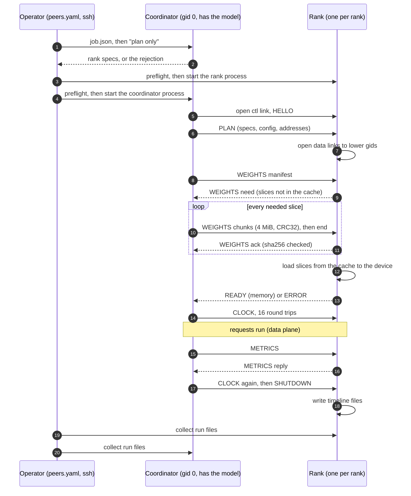
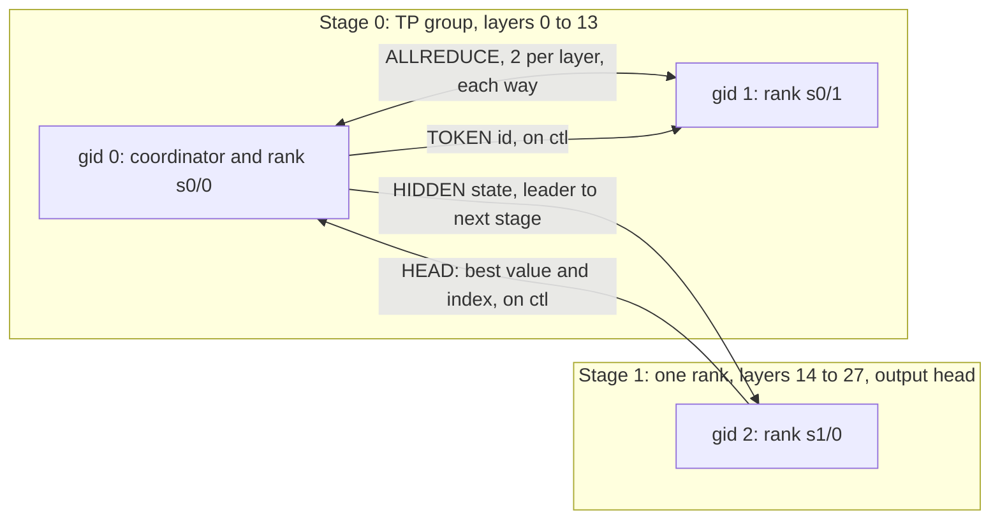

# Engine design: how a run of our engine works, step by step

Status: describes the code at session 10, part 1 (2026-11-28). Written for the design walkthrough with the supervisor.
The engine is `nocturne/engines/torch_tp/`. It is engine B of ADR-007. Nothing here is about llama.cpp.
How every reported number is measured is in `docs/MEASUREMENT.md`.

## 1. What is ours and what is PyTorch

| part | whose | where |
|---|---|---|
| Tensors, matrix multiply, attention kernel, device memory, the MPS and CUDA backends | PyTorch | `torch` |
| Tokenizer and chat template | Hugging Face `transformers`, on the coordinator only | `gguf_source.load_tokenizer` |
| Reading a GGUF header and tensor table | `gguf-py` of llama.cpp | `gguf_source.py` |
| Reading a slice of a safetensors file | `safetensors` | `loader.py` |
| The transformer blocks, cut into slices | ours | `model.py`, `shard.py` |
| Quantized weights kept quantized on the device, expanded just before a multiply | ours | `quant.py` |
| The planner: which rank holds which heads, MLP rows, vocab rows, and how many bytes | ours | `plan.py` |
| The transport: TCP links, frames, counters | ours | `transport.py` |
| The all-reduce between the ranks of a group, the pipeline between stages | ours | `hybrid.py` |
| The coordinator: plan, links, weight shipping, generation loop | ours | `hybrid.py`, `coordinate.py`, `shipping.py` |
| The operator: start processes over ssh, collect files, write the record | ours | `operate.py`, `hybrid_run.py` |
| Clock alignment, recorder, timeline | ours | `clock.py`, `recorder.py`, `timeline.py` |

The engine uses PyTorch as a tensor library. It does not use `torch.distributed`, MPI or any PyTorch model class.
The same Python code runs on Metal (`mps`) and on CUDA. Section 9 lists the three places where the device matters.

One step is "compute, then send, then wait". This is a choice of our engine: the all-reduce blocks, a tensor is copied to the host with a device sync before it is sent, and a stage runs one request at a time. It is not a limit of PyTorch on Metal.

## 2. Three roles

| role | how many | what it does | what it needs |
|---|---|---|---|
| **Operator** | one machine | Holds `peers.yaml`. Starts every process over ssh. Collects files. Writes `record.json`. Not part of the engine | ssh to every host, the repository |
| **Coordinator** | one process, on the host the placement names | The requester. Plans. Opens the control links. Ships weights. Tokenizes. Runs the generation loop. It is also rank 0 of the first stage, so it computes too | the model file, `torch`, `transformers`, `gguf` |
| **Rank** (worker) | one process per rank | Holds one slice of the model on one device. Computes its part of every step | `torch`. No model file when weights are shipped |

Any joined machine can be the coordinator: a Mac or a Linux or WSL2 machine. The operator can be a third machine.
On 2026-11-28 the operator is the M5. A placement says `coordinator: {host: gtx}` to make gtx the coordinator.

What is installed on every machine: Python 3.11 or newer, a virtual environment with `torch` for its GPU, and this repository at the same commit (the operator compares a hash of the engine files before every run). `psutil` for the sampler.

## 3. The steps of a run

### 3.1 Join (once per machine)

The new machine runs `scripts/15_join.sh`. It checks the network, ssh, the GPU, `torch`, the firewall ports 50070 to 50079, and writes a report.
The operator applies the report: `scripts/16_join_apply.py apply` adds the machine to `~/.nocturne/peers.yaml` and to `~/.ssh/config`. See `docs/JOIN.md`.

### 3.2 Peers

`~/.nocturne/peers.yaml` lives on the operator. Per host it holds: the ssh alias, the Python path, the address to listen on (`bind`), the backend (metal, cuda), and optionally where that host keeps a model (`models`).
The coordinator does not read peers.yaml. It gets the host addresses inside the job.

### 3.3 Placement: the planner's input

A placement is a YAML file written by a person. It fixes the structure: the stages in order, the layer range of each stage, and the ranks of each stage with host, device and port.
A stage with one rank is a pipeline stage (PP). A stage with several ranks is a tensor parallel group (TP). A mix is a hybrid.
Optional per rank: `weight` or `budget_gb` (its share), `heads` (a forced head count).

### 3.4 Planning: the planner's output

`plan(dims, placement)` is a pure function. Its input is the placement and the model's numbers: sizes, and for a GGUF file the quantization type of every tensor.
For every rank it returns a `RankSpec`:

- the layer range,
- a contiguous range of attention heads, and the KV heads that follow from it,
- a contiguous range of MLP rows,
- a range of vocabulary rows of the embedding and of the output head, where its stage holds them,
- planned bytes: weights, KV cache, workspace, and the total against the budget.

Inside a group it splits heads by share, then vocab rows by share, then fills each rank with MLP rows up to its share of the bytes.
For quantized files it cuts row split layers only at block boundaries (32 columns for Q8_0, 256 for the K types).
It rejects a placement in which a rank is over its budget, and names the rank.
The planner runs in the coordinator process, because it needs the model file. The operator needs only the list of ranks (host, port, order), which `plan.slots` gives without the model.

What the planner does not do yet: choose the stages and the hosts by itself. That is the placement algorithm of objective O5.

### 3.5 Launch

The operator (`hybrid_run`):

1. Reads the placement and peers.yaml. Finds the coordinator host: rank 0 of the first stage.
2. Writes `job.json` on the coordinator host: the placement, the host addresses, the model path on that host, the prompts, the options.
3. Asks the coordinator host for the plan (`coordinate --plan-only`). A rejected plan ends the run here.
4. Preflight on every host: ssh works, the engine files are the same, the clock offset (`timesync`), the host state. On the hosts that hold the model: the file hash.
5. Starts one `rank` process per rank, each on its host, each listening on its port.
6. Starts the `coordinate` process on the coordinator host and follows its log.

### 3.6 Links: who connects to whom

Every rank listens on one TCP port. It listens on `127.0.0.1` for a peer on its own host and on its `bind` address for a peer on another host. Never on `0.0.0.0`.
The ports accept any peer. Security is deferred by ADR-009, not forgotten. Use them only on a network you control.

Ranks are numbered in stage order, then rank order: the global id (gid). The coordinator is gid 0.

| link | from | to | carries |
|---|---|---|---|
| control (`ctl`) | the coordinator | every other rank | the plan, weights, clock, token ids to the first stage, head results back, metrics, errors |
| group | every rank of a group | every other rank of the same group | all-reduce partial sums |
| pipeline | the leader of a stage (its rank 0) | every rank of the next stage | the hidden state |

For a data link the rank with the higher gid connects and the lower one accepts. A connection opens with a HELLO frame that says `ctl` or `data` and the gid.
Workers talk to each other directly. Nothing is relayed through the coordinator.

### 3.7 The plan message

On each control link the coordinator sends one PLAN frame (JSON): all rank specs, the gid of the receiver, the host addresses, the model config, the sequence length, where partial sums are added (`reduce_dtype`), and whether to record a timeline.
From this a rank knows its slice and its peers. It then opens its data links.

### 3.8 Weight shipping

The rule: a worker does not hold the model. The coordinator sends each rank exactly the bytes that rank computes with. `--ship-weights` is on by default. `--no-ship-weights` is the old behaviour: every host reads its own copy.

A **slice** is the part of one tensor that one rank holds: a row range or a column range, as the plan says. Its bytes are the bytes of the file: stored quantization blocks for a quantized tensor, raw values for a dense one. Nothing is converted for the wire.

1. **Manifest.** After planning, the coordinator builds a manifest per rank: for every slice the tensor name, the row and column range, the type, the shape, the byte size and the sha256, and the total.
2. **Need.** The rank looks in its cache, `~/.nocturne/cache/<model sha256>/<slice sha256>`. It answers with the list of slices it lacks. It also checks the free disk space.
3. **Chunks.** For each needed slice the coordinator sends chunks of at most 4 MiB. Each chunk carries a CRC32. The rank checks it, appends the chunk to a temporary file and feeds the sha256.
4. **End and ack.** At the end of a slice the rank compares the sha256 with the manifest. If it matches, the file is renamed into the cache and the rank answers "accepted". If a chunk or the hash is wrong, the file is deleted and the rank answers "rejected". The coordinator then stops the run and names the rank and the slice.
5. **Load.** The rank loads its slices from the cache to the device, through the same loader interface (`TensorSource`) as a local file. The file is memory mapped, so a slice is never held twice in memory.

The coordinator serves all ranks at once, one thread per control link, and loads its own slice from the local file in the meantime.
A second run of the same placement ships 0 bytes. A different placement of the same model ships only the slices whose cut changed.
Per rank the record holds: manifest bytes, shipped bytes, bytes found in the cache, shipping time, and the number of hash checks.

Shipped bytes against planned bytes. The manifest counts stored bytes. For safetensors they equal the planned weight bytes exactly.
For a GGUF file two things differ, and the record names both per rank (`loaded_tensor_bytes`, `planned_weight_bytes`, `stored_minus_loaded_bytes`):
norm and bias vectors are stored as float32 and shipped as stored, while the loader holds them as bf16 and the planner counts them so; and the planner averages bytes per row over the layers of a stage, which can leave a few bytes of rounding.
Manifest bytes minus `stored_minus_loaded_bytes` equal the loaded bytes exactly.

Model identity: the sha256 of the GGUF file, or for a safetensors directory the sha256 over the sorted names and hashes of its files.

### 3.9 Ready and clocks

A rank that has loaded its slice sends READY with its memory numbers. If it failed (out of memory, a rejected slice, no disk space) it sends ERROR with the text, and the coordinator ends the run with the rank's name.
Right after READY the coordinator measures every rank's clock offset: 16 round trips on the control link, smallest round trip kept. It does this again before shutdown. See `docs/MEASUREMENT.md`.

### 3.10 The decode loop

One step produces one token. The first step of a request is the prefill: the same path with all prompt tokens at once.

1. The coordinator sends the new token id to the other ranks of the first stage (TOKEN frame).
2. Every rank of the first stage looks up its rows of the embedding. Rows it does not hold give zeros. One all-reduce completes the embedding.
3. Every rank of a stage runs its layers. In each layer it computes attention over its heads and the MLP over its rows. These are partial sums.
   After the attention and after the MLP the group does an **all-reduce**: every rank sends its partial to every other rank of the group, and each adds all partials in the same order, on the host, in float32, rounded once. All ranks of a group then hold the same bytes. That is 2 all-reduces per layer.
   A stage with one rank has no all-reduce.
4. The leader of the stage sends the hidden state to every rank of the next stage (HIDDEN frame). The next stage repeats step 3.
5. Every rank of the last stage computes the logits of its vocabulary rows and sends its best (value, index) to the coordinator (HEAD frame).
6. The coordinator picks the largest value, ties to the lowest index. That is greedy decoding. The token goes back to step 1.

Frames per decode step are predicted by a formula (`plan.frames_per_step`) and counted on every link. Every recorded run checks that the two agree.
Each rank keeps its own KV cache for its own heads, so no cache travels.

### 3.11 Metrics and the recorder

On request, every rank reports its memory, loaded bytes and link counters over its control link.
With `--timeline` every rank also records what it does in every step: compute, copy between device and host, send, wait. Section 3 of `docs/MEASUREMENT.md` has the details.

### 3.12 Shutdown

The coordinator measures the clocks again, then sends SHUTDOWN along the data path. Every rank writes its timeline files and exits.
The coordinator writes `coordinator_record.json`. The operator copies the files of every host into the run folder and writes `record.json`.
It first waits for the rank processes to end, because each rank writes its timeline files as it exits.
Then it stops what is left on every host: `pkill` (SIGTERM) for every process that carries this run's tag. A rank that is blocked on a dead link ends this way. Rank and coordinator processes turn SIGTERM into a normal exit, so their files are closed and the sampler stops.

## 4. Control plane

## 5. Data plane

One decode step of a hybrid placement: stage 0 is a TP group of two ranks, stage 1 is one rank that also holds the output head.

Sizes for Qwen2.5 7B: a hidden state frame is 7 kB (3584 values in bf16 plus the header). A token frame and a head frame are tens of bytes.
In this placement one step sends 61 frames: 1 token, 2 for the embedding, 56 for 14 layers, 1 hop, 1 head.

## 6. Frames

A frame is a 16 byte header (payload length, kind, dtype code, number of dims, two 32 bit fields), the dims, then raw bytes. `transport.py` documents it.

| kind | direction | payload |
|---|---|---|
| HELLO | connecting side | role and gid |
| PLAN | coordinator to rank | JSON plan |
| WEIGHTS | both, on ctl | manifest, need list, chunk, end, ack, done |
| READY, ERROR | rank to coordinator | JSON |
| CLOCK | both, on ctl | request, or the rank's wall and monotonic time |
| TOKEN | coordinator to first stage | token ids |
| ALLREDUCE | inside a group | a partial sum |
| HIDDEN | leader to next stage | the hidden state |
| HEAD | last stage to coordinator | best value and index, or logits |
| METRICS, RESET, SHUTDOWN | coordinator, then along the data path | none or JSON |

Session 10 changed three things on the wire, and nothing else:

1. The WEIGHTS kind (section 3.8).
2. The CLOCK kind (section 3.9).
3. In TOKEN and HIDDEN frames the second 32 bit field held only flags in its low byte. Its upper 24 bits now carry the request number, in every run. The recorder reads it. The frame size and every other field are unchanged.

## 7. Why the result does not depend on the split

- A stage with one rank computes exactly what one machine computes. A pipeline of such stages is bit identical to one rank on the same device type.
- In a TP group every rank adds the same partials in the same order on the host. So the shared state is the same on all ranks.
- What can differ is rounding inside a rank's own slice. Every recorded run is compared, token by token, with a one rank reference.

## 8. Failures

There is no recovery. A broken link ends the run and the record says which link. A rank that fails while loading sends its error text first.
A wrong chunk or hash during shipping ends the run. Nothing wrong can enter the cache, because a file gets its cache name only after its sha256 matched.

## 9. The same flow on Metal and on CUDA

The code path is the same. Three things depend on the device:

| what | Metal (`mps`) | CUDA |
|---|---|---|
| waiting for the device before a copy or a time stamp | `torch.mps.synchronize()` | `torch.cuda.synchronize()` |
| memory numbers in the record | MPS allocations, process footprint | VRAM total and free, peak allocation |
| memory behaviour | a tensor of 10 MiB or more takes a 1 GiB heap | plain allocation |

A TP group may mix Metal and CUDA only with `allow_mixed_devices: true`, because the kernels round differently.

## 10. Known limits

- The placement structure is written by hand. The planner splits inside it.
- Greedy decoding only. One request at a time per stage.
- The slice cache is never cleaned. A rank on the coordinator's own host still gets its slices through the cache, so that host holds those bytes twice on disk.
- A cached slice is trusted by its name and size. It was checked by sha256 when it was written, and it got its name only after its bytes were on the disk.
- The coordinator remembers slice hashes per model. That memo is dropped when the code that cuts slices changes.
- The raw recorder files are gzipped (`timeline_<rank>.jsonl.gz`, `trace.json.gz`): a TP run of 500 steps is 7 MB per rank and a 60 MB trace as plain text.
- A native Windows peer is not supported (WSL2 only).
