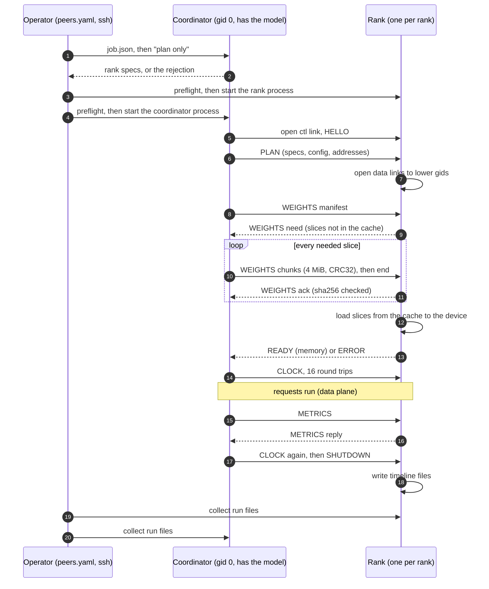
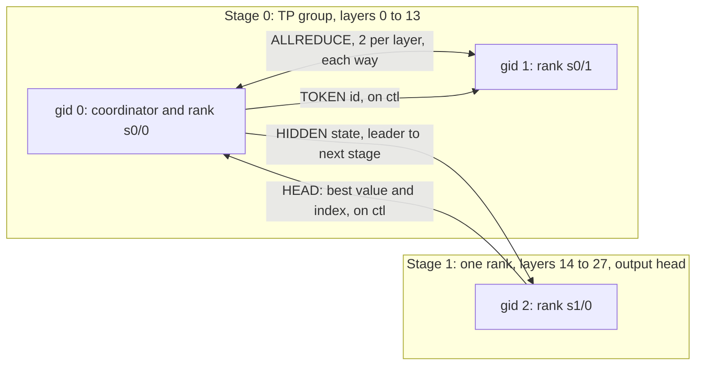

# Engine design: how a run of our engine works, step by step

Status: describes the code at session 10, part 1 (2026-11-28). Written for the design walkthrough with the supervisor.
The engine is `nocturne/engines/torch_tp/`. It is engine B of ADR-007. Nothing here is about llama.cpp.
How every reported number is measured is in `docs/MEASUREMENT.md`.

## 1. What is ours and what is PyTorch

| part | whose | where |
|---|---|---|
| Tensors, matrix multiply, attention kernel, device memory, the MPS and CUDA backends | PyTorch | `torch` |
| Tokenizer and chat template | Hugging Face `transformers`, on the coordinator only | `gguf_source.load_tokenizer` |
| Reading a GGUF header and tensor table | `gguf-py` of llama.cpp | `gguf_source.py` |
| Reading a slice of a safetensors file | `safetensors` | `loader.py` |
| The transformer blocks, cut into slices | ours | `model.py`, `shard.py` |
| Quantized weights kept quantized on the device, expanded just before a multiply | ours | `quant.py` |
| The planner: which rank holds which heads, MLP rows, vocab rows, and how many bytes | ours | `plan.py` |
| The transport: TCP links, frames, counters | ours | `transport.py` |
| The all-reduce between the ranks of a group, the pipeline between stages | ours | `hybrid.py` |
| The coordinator: plan, links, weight shipping, generation loop | ours | `hybrid.py`, `coordinate.py`, `shipping.py` |
| The operator: start processes over ssh, collect files, write the record | ours | `operate.py`, `hybrid_run.py` |
| Clock alignment, recorder, timeline | ours | `clock.py`, `recorder.py`, `timeline.py` |

The engine uses PyTorch as a tensor library. It does not use `torch.distributed`, MPI or any PyTorch model class.
The same Python code runs on Metal (`mps`) and on CUDA. Section 9 lists the three places where the device matters.

One step is "compute, then send, then wait". This is a choice of our engine: the all-reduce blocks, a tensor is copied to the host with a device sync before it is sent, and a stage runs one request at a time. It is not a limit of PyTorch on Metal.

## 2. Three roles

| role | how many | what it does | what it needs |
|---|---|---|---|
| **Operator** | one machine | Holds `peers.yaml`. Starts every process over ssh. Collects files. Writes `record.json`. Not part of the engine | ssh to every host, the repository |
| **Coordinator** | one process, on the host the placement names | The requester. Plans. Opens the control links. Ships weights. Tokenizes. Runs the generation loop. It is also rank 0 of the first stage, so it computes too | the model file, `torch`, `transformers`, `gguf` |
| **Rank** (worker) | one process per rank | Holds one slice of the model on one device. Computes its part of every step | `torch`. No model file when weights are shipped |

Any joined machine can be the coordinator: a Mac or a Linux or WSL2 machine. The operator can be a third machine.
On 2026-11-28 the operator is the M5. A placement says `coordinator: {host: gtx}` to make gtx the coordinator.

What is installed on every machine: Python 3.11 or newer, a virtual environment with `torch` for its GPU, and this repository at the same commit (the operator compares a hash of the engine files before every run). `psutil` for the sampler.

## 3. The steps of a run

### 3.1 Join (once per machine)

The new machine runs `scripts/15_join.sh`. It checks the network, ssh, the GPU, `torch`, the firewall ports 50070 to 50079, and writes a report.
The operator applies the report: `scripts/16_join_apply.py apply` adds the machine to `~/.nocturne/peers.yaml` and to `~/.ssh/config`. See `docs/JOIN.md`.

### 3.2 Peers

`~/.nocturne/peers.yaml` lives on the operator. Per host it holds: the ssh alias, the Python path, the address to listen on (`bind`), the backend (metal, cuda), and optionally where that host keeps a model (`models`).
The coordinator does not read peers.yaml. It gets the host addresses inside the job.

### 3.3 Placement: the planner's input

A placement is a YAML file written by a person. It fixes the structure: the stages in order, the layer range of each stage, and the ranks of each stage with host, device and port.
A stage with one rank is a pipeline stage (PP). A stage with several ranks is a tensor parallel group (TP). A mix is a hybrid.
Optional per rank: `weight` or `budget_gb` (its share), `heads` (a forced head count).

### 3.4 Planning: the planner's output

`plan(dims, placement)` is a pure function. Its input is the placement and the model's numbers: sizes, and for a GGUF file the quantization type of every tensor.
For every rank it returns a `RankSpec`:

- the layer range,
- a contiguous range of attention heads, and the KV heads that follow from it,
- a contiguous range of MLP rows,
- a range of vocabulary rows of the embedding and of the output head, where its stage holds them,
- planned bytes: weights, KV cache, workspace, and the total against the budget.

Inside a group it splits heads by share, then vocab rows by share, then fills each rank with MLP rows up to its share of the bytes.
For quantized files it cuts row split layers only at block boundaries (32 columns for Q8_0, 256 for the K types).
It rejects a placement in which a rank is over its budget, and names the rank.
The planner runs in the coordinator process, because it needs the model file. The operator needs only the list of ranks (host, port, order), which `plan.slots` gives without the model.

What the planner does not do yet: choose the stages and the hosts by itself. That is the placement algorithm of objective O5.

### 3.5 Launch

The operator (`hybrid_run`):

1. Reads the placement and peers.yaml. Finds the coordinator host: rank 0 of the first stage.
2. Writes `job.json` on the coordinator host: the placement, the host addresses, the model path on that host, the prompts, the options.
3. Asks the coordinator host for the plan (`coordinate --plan-only`). A rejected plan ends the run here.
4. Preflight on every host: ssh works, the engine files are the same, the clock offset (`timesync`), the host state. On the hosts that hold the model: the file hash.
5. Starts one `rank` process per rank, each on its host, each listening on its port.
6. Starts the `coordinate` process on the coordinator host and follows its log.

The operator also watches that process apart from its log. The coordinator prints a sign of life every 20 s from its own thread. When none arrives for 300 s (`--stall-timeout`), because the process hangs, was stopped, or its host left the network, the operator ends it, writes `outcome: coordinator_stalled` with the reason into `record.json`, and still collects the files and cleans up. This is a liveness check. It is not a limit on how long a run may take.

### 3.6 Links: who connects to whom

Every rank listens on one TCP port. It listens on `127.0.0.1` for a peer on its own host and on its `bind` address for a peer on another host. Never on `0.0.0.0`.
The ports accept any peer. Security is deferred by ADR-009, not forgotten. Use them only on a network you control.

Ranks are numbered in stage order, then rank order: the global id (gid). The coordinator is gid 0.

| link | from | to | carries |
|---|---|---|---|
| control (`ctl`) | the coordinator | every other rank | the plan, weights, clock, token ids to the first stage, head results back, metrics, errors |
| group | every rank of a group | every other rank of the same group | all-reduce partial sums |
| pipeline | the leader of a stage (its rank 0) | every rank of the next stage | the hidden state |

For a data link the rank with the higher gid connects and the lower one accepts. A connection opens with a HELLO frame that says `ctl` or `data` and the gid.
Workers talk to each other directly. Nothing is relayed through the coordinator.

### 3.7 The plan message

On each control link the coordinator sends one PLAN frame (JSON): all rank specs, the gid of the receiver, the host addresses, the model config, the sequence length, where partial sums are added (`reduce_dtype`), and whether to record a timeline.
From this a rank knows its slice and its peers. It then opens its data links.

### 3.8 Weight shipping

The rule: a worker does not hold the model. The coordinator sends each rank exactly the bytes that rank computes with. `--ship-weights` is on by default. `--no-ship-weights` is the old behaviour: every host reads its own copy.

A **slice** is the part of one tensor that one rank holds: a row range or a column range, as the plan says. Its bytes are the bytes of the file: stored quantization blocks for a quantized tensor, raw values for a dense one. Nothing is converted for the wire.

1. **Manifest.** After planning, the coordinator builds a manifest per rank: for every slice the tensor name, the row and column range, the type, the shape, the byte size and the sha256, and the total.
2. **Need.** The rank looks in its cache, `~/.nocturne/cache/<model sha256>/<slice sha256>`. It answers with the list of slices it lacks. It also checks the free disk space.
3. **Chunks.** For each needed slice the coordinator sends chunks of at most 4 MiB. Each chunk carries a CRC32. The rank checks it, appends the chunk to a temporary file and feeds the sha256.
4. **End and ack.** At the end of a slice the rank compares the sha256 with the manifest. If it matches, the file is renamed into the cache and the rank answers "accepted". If a chunk or the hash is wrong, the file is deleted and the rank answers "rejected". The coordinator then stops the run and names the rank and the slice.
5. **Load.** The rank loads its slices from the cache to the device, through the same loader interface (`TensorSource`) as a local file. The file is memory mapped, so a slice is never held twice in memory.

The coordinator serves all ranks at once, one thread per control link, and loads its own slice from the local file in the meantime.
A second run of the same placement ships 0 bytes. A different placement of the same model ships only the slices whose cut changed.
A cached slice is trusted by its name and size. `--verify-cache` makes every rank read and hash its cached slices before it trusts them, and ask again for any that differ. That costs one sequential read of the cached bytes per run.
On the coordinator a slice is hashed and sent in pieces. A slice that is not one block of memory (a column range of a safetensors matrix) is copied a few rows at a time, never as a whole.
Per rank the record holds: manifest bytes, shipped bytes, bytes found in the cache, shipping time, and the number of hash checks.

Shipped bytes against planned bytes. The manifest counts stored bytes. For safetensors they equal the planned weight bytes exactly.
For a GGUF file two things differ, and the record names both per rank (`loaded_tensor_bytes`, `planned_weight_bytes`, `stored_minus_loaded_bytes`):
norm and bias vectors are stored as float32 and shipped as stored, while the loader holds them as bf16 and the planner counts them so; and the planner averages bytes per row over the layers of a stage, which can leave a few bytes of rounding.
Manifest bytes minus `stored_minus_loaded_bytes` equal the loaded bytes exactly.

Model identity: the sha256 of the GGUF file, or for a safetensors directory the sha256 over the sorted names and hashes of its files.

### 3.9 Ready and clocks

A rank that has loaded its slice sends READY with its memory numbers. If it failed (out of memory, a rejected slice, no disk space) it sends ERROR with the text, and the coordinator ends the run with the rank's name.
Right after READY the coordinator measures every rank's clock offset: 16 round trips on the control link, smallest round trip kept. It does this again before shutdown. See `docs/MEASUREMENT.md`.

### 3.10 The decode loop

One step produces one token. The first step of a request is the prefill: the same path with all prompt tokens at once.

1. The coordinator sends the new token id to the other ranks of the first stage (TOKEN frame).
2. Every rank of the first stage looks up its rows of the embedding. Rows it does not hold give zeros. One all-reduce completes the embedding.
3. Every rank of a stage runs its layers. In each layer it computes attention over its heads and the MLP over its rows. These are partial sums.
   After the attention and after the MLP the group does an **all-reduce**: every rank sends its partial to every other rank of the group, and each adds all partials in the same order, on the host, in float32, rounded once. All ranks of a group then hold the same bytes. That is 2 all-reduces per layer.
   A stage with one rank has no all-reduce.
4. The leader of the stage sends the hidden state to every rank of the next stage (HIDDEN frame). The next stage repeats step 3.
5. Every rank of the last stage computes the logits of its vocabulary rows and sends its best (value, index) to the coordinator (HEAD frame).
6. The coordinator picks the largest value, ties to the lowest index. That is greedy decoding. The token goes back to step 1.

Frames per decode step are predicted by a formula (`plan.frames_per_step`) and counted on every link. Every recorded run checks that the two agree.
Each rank keeps its own KV cache for its own heads, so no cache travels.

### 3.11 Metrics and the recorder

On request, every rank reports its memory, loaded bytes and link counters over its control link.
With `--timeline` every rank also records what it does in every step: compute, copy between device and host, send, wait. Section 3 of `docs/MEASUREMENT.md` has the details.

### 3.12 Shutdown

The coordinator measures the clocks again, then sends SHUTDOWN along the data path. Every rank writes its timeline files and exits.
The coordinator writes `coordinator_record.json`. The operator copies the files of every host into the run folder and writes `record.json`.
It first waits for the rank processes to end, because each rank writes its timeline files as it exits.
Then it stops what is left on every host: `pkill` (SIGTERM, and SIGKILL two seconds later for what is still there) for every process that carries this run's tag. A rank that is blocked on a dead link ends this way. Rank and coordinator processes turn SIGTERM into a normal exit, so their files are closed and the sampler stops.

## 4. Control plane

## 5. Data plane

One decode step of a hybrid placement: stage 0 is a TP group of two ranks, stage 1 is one rank that also holds the output head.

Sizes for Qwen2.5 7B: a hidden state frame is 7 kB (3584 values in bf16 plus the header). A token frame and a head frame are tens of bytes.
In this placement one step sends 61 frames: 1 token, 2 for the embedding, 56 for 14 layers, 1 hop, 1 head.

## 6. Frames

A frame is a 16 byte header (payload length, kind, dtype code, number of dims, two 32 bit fields), the dims, then raw bytes. `transport.py` documents it.

| kind | direction | payload |
|---|---|---|
| HELLO | connecting side | role and gid |
| PLAN | coordinator to rank | JSON plan |
| WEIGHTS | both, on ctl | manifest, need list, chunk, end, ack, done |
| READY, ERROR | rank to coordinator | JSON |
| CLOCK | both, on ctl | request, or the rank's wall and monotonic time |
| TOKEN | coordinator to first stage | token ids |
| ALLREDUCE | inside a group | a partial sum |
| HIDDEN | leader to next stage | the hidden state |
| HEAD | last stage to coordinator | best value and index, or logits |
| METRICS, RESET, SHUTDOWN | coordinator, then along the data path | none or JSON |

Session 10 changed three things on the wire, and nothing else:

1. The WEIGHTS kind (section 3.8).
2. The CLOCK kind (section 3.9).
3. In TOKEN and HIDDEN frames the second 32 bit field holds flags in its low byte. In a run with `--timeline` bits 8 to 23 carry the request number, which the recorder reads. Without `--timeline` they are zero, so those frames are byte for byte what they were before session 10. The frame size and every other field are unchanged.
4. Part 3 (section 11.7): two more flag bits in that low byte (no head for this chunk, first of a pair), the slot in bits 24 to 31 of the same field, and the slot in bits 24 to 31 of the first field of a HEAD frame. All of them are zero when every overlap option is off.

CLOCK and WEIGHTS frames travel only on control links, never on a group or pipeline link. A rank of a later stage waits on its upstream link and on its control link at the same time, so the coordinator can reach it for the end clock measurement without using the data path.

## 7. Why the result does not depend on the split

- A stage with one rank computes exactly what one machine computes. A pipeline of such stages is bit identical to one rank on the same device type.
- In a TP group every rank adds the same partials in the same order on the host. So the shared state is the same on all ranks.
- What can differ is rounding inside a rank's own slice. Every recorded run is compared, token by token, with a one rank reference.

## 8. Failures

There is no recovery. A broken link ends the run and the record says which link. A rank that fails while loading sends its error text first.
A send that finds no kernel buffer space for a moment (ENOBUFS, seen on the macOS loopback during shipping) waits and goes on; the run does not end.
A coordinator that gives no sign of life is ended by the operator (section 3.5). An ssh connection to a host that left the network ends by itself after about a minute.
A wrong chunk or hash during shipping ends the run. Nothing wrong can enter the cache, because a file gets its cache name only after its sha256 matched.

## 9. The same flow on Metal and on CUDA

The code path is the same. Three things depend on the device:

| what | Metal (`mps`) | CUDA |
|---|---|---|
| waiting for the device before a copy or a time stamp | `torch.mps.synchronize()` | `torch.cuda.synchronize()` |
| memory numbers in the record | MPS allocations, process footprint | VRAM total and free, peak allocation |
| memory behaviour | a tensor of 10 MiB or more takes a 1 GiB heap | plain allocation |

A TP group may mix Metal and CUDA only with `allow_mixed_devices: true`, because the kernels round differently.

## 10. Known limits

- The placement structure is written by hand. The planner splits inside it.
- Greedy decoding only. One request at a time per stage.
- The slice cache is never cleaned. A rank on the coordinator's own host still gets its slices through the cache, so that host holds those bytes twice on disk.
- A cached slice is trusted by its name and size. It was checked by sha256 when it was written, and it got its name only after its bytes were on the disk.
- The coordinator remembers slice hashes per model. That memo is dropped when the code that cuts slices changes.
- The raw recorder files are gzipped (`timeline_<rank>.jsonl.gz`, `trace.json.gz`): a TP run of 500 steps is 7 MB per rank and a 60 MB trace as plain text.
- A native Windows peer is not supported (WSL2 only).

## 11. Overlap: compute while data is on the network

Status: built (session 10, part 3). The design was written on 2026-11-28 before the code and then kept in step with it. Verification: `experiments/session10_cuda_pair/VERIFY_overlap.md`.

### 11.1 The problem and the rule

Today every machine computes, sends, then waits (section 1). On two Macs in PP a machine waited more than half of each token. In TP it waited two thirds.
A machine can only fill that wait with other work. Inside one conversation the next token needs the previous one, so the other work is another request, or another part of the same prompt.

Two goals:

1. A machine computes other work while its data is on the network.
2. With several units of work in the pipeline, no machine waits long. For that a machine may hold several layer ranges that are not adjacent (the Megatron interleaved schedule).

The rule that does not move: **the tokens of a request do not depend on how the work was scheduled.**
Every feature is an option. Every option is off by default. An option at its off value gives the old behaviour byte for byte: the same frames, the same bytes per link, the same tokens.

| option | off value | what it does | for |
|---|---|---|---|
| `--slots K` | 1 | up to K requests in flight | PP, hybrid, and TP together with `--tp-interleave` |
| `--prefill-chunk C` | 0 (whole prompt) | the prompt travels in chunks of C tokens | PP, hybrid |
| `--tp-interleave 2` | 1 | two requests share a TP group in lockstep | TP groups |
| `--async-send` | off | the copy to the host and the send leave the compute thread | all |
| a host in several stages | (a placement, not a flag) | interleaved pipeline stages | PP, hybrid |

### 11.2 O1. Several requests in flight (`--slots K`)

**State.** Every rank keeps its KV cache with a slot dimension: K caches instead of one. The planner counts K times the KV bytes. With K = 1 the tensors are the ones of today.

**On the wire.** Every TOKEN, HIDDEN and HEAD frame carries the slot id (section 6). Slot 0 writes zeros into bits that are zero today, so K = 1 changes no byte.

**A rank** does not schedule. It processes frames in the order they arrive on its upstream link and uses the slot of each frame. A link keeps order. The leader of a stage sends the same sequence to every rank of the next stage, so all ranks of a group see the same order and their all-reduces pair up.

**The coordinator** schedules. It keeps a table of slots. A slot is ready when its next input exists: the prompt at the start, later the token it just chose.

1. While a slot is ready, the coordinator runs the first stage for it (it is rank 0 of that stage) and the hidden state leaves for the next stage.
2. Between steps it reads the HEAD frames that have arrived, without blocking. When all head ranks have answered for a slot, it chooses the token of that slot. The slot is ready again, or its request is finished and the slot takes the next waiting request.
3. When no slot is ready it blocks on the head links.

So stage 1 works on request A while stage 0 works on request B.
Order of service is first ready, first served.

**Why the tokens are the same.** A step of one slot reads and writes only that slot's cache and that slot's hidden state, with the same operations on the same shapes as when the request runs alone. Requests are never batched into one tensor.

**Recorded.** Per request: tokens, the slot it used, start and end. Per run: tokens per second of the whole system. `ms_per_step` of one request is still recorded but now includes waiting for the other slots.

### 11.3 O2. Chunked prefill (`--prefill-chunk C`)

The prompt of T tokens is cut into chunks of C tokens. A chunk is a step like any other, with its position offset. The first stage computes chunk 1 and sends it on, then computes chunk 2 while the second stage computes chunk 1.

- A chunk attends to the cached prefix of its own request and causally inside itself. This path exists (`pos0 > 0`).
- Only the last chunk needs the output head. The other chunks carry a "no head" flag, and the head ranks send nothing for them.
- A last chunk of one token would look like a decode step to the counters. So a remainder of one token is joined to the chunk before it.
- With slots, chunks of different requests interleave freely.

**Tokens.** The math is the same as for the whole prompt. The attention kernel runs on other shapes, so the rounding can differ in the last bit. The criterion is at least 7 of 8 prompts identical to unchunked prefill, with the first step logit difference reported and any difference explained.

### 11.4 O3. Two requests interleaved in a TP group (`--tp-interleave 2`)

In a TP group a rank waits for its peers twice per layer. With two requests A and B the group fills that wait:

1. compute A's partial sum, send it, do not wait;
2. compute B's partial sum, send it;
3. receive the peers' partials for A and add them, then the same for B.

A's transfer happens behind B's compute. This repeats for every all-reduce: the embedding, and after the attention and after the MLP of every layer.

- The all-reduce is split into its two halves, "send my partial" and "receive and add". The plain all-reduce is the first half followed at once by the second, which is what the code does today.
- The add order inside each all-reduce stays as it is: all partials in group rank order, in float32, rounded once. The sums are the same bytes.
- Every rank of the group handles A before B, so on every link the frames arrive in the order A, B.
- The coordinator forms the pair when two slots are ready. The first frame of a pair carries a "pair" flag, and the receiver then reads the partner before it starts. The flag travels with the pair through later stages. A stage with one rank just computes A, then B. With one slot ready, the step runs alone as today.
- It needs `--slots` of 2 or more.
- **How often a pair forms.** A pair needs two slots ready at the same moment. In a pure TP group the two head results come back together, so with two slots most steps are pairs. Behind a later stage they come back one step apart, and with two slots almost every step then runs alone (measured on loopback: 12 of 80 steps in pairs). With four slots two are always ready. The scheduler does not wait for a partner, because the first stage would then idle while a later stage works. The record says what happened: `overlap.pair_steps`, `overlap.single_steps` and `overlap.max_in_flight`.
- **Memory.** A rank of a group holds the work space of two requests during a pair. The planner doubles the work space of group ranks when the option is on.
- **Socket buffers.** Every rank sends before it receives, so what it sends on its own thread must fit the kernel's send buffer without the peer reading. A pair doubles that. The engine asks for 8 MiB and reads back what it got: 8 MiB on the Macs, 425984 bytes on Linux with the default `net.core.wmem_max` (measured on gtx). A frame goes inline only when it and the inline frames of its pair partner fit half the granted size; otherwise it leaves on a helper thread, in order. Before this rule a pair of 7B prefill frames could have blocked both Linux ranks for good, and so could a single frame between about 0.4 and 1 MiB in the old path.

### 11.5 O4. Send without blocking the device (`--async-send`)

Without the option a rank waits for the device, copies the tensor to the host, and sends, all on the compute thread.
With the option every rank has one more thread, the sender (`hybrid.Sender`). The compute thread hands over a tensor and the frames that carry it, and goes on. The sender takes the work in the order it was handed over: it waits until the tensor is on the host, then it sends.

Where the copy to the host runs, per device (recorded per rank in `record.json`, `ranks[].async_send.copy`):

| device | mode | what happens |
|---|---|---|
| CUDA | `pinned` | The compute thread queues a non blocking copy into pinned host memory and records a device event after it. The sender waits for that event. Pinned buffers are reused per shape |
| MPS | `inline` | The copy stays on the compute thread, which waits for the device as before. Only the send moves to the sender |
| CPU | `inline` | The tensor is already on the host |

`NOCTURNE_ASYNC_COPY` (`pinned`, `thread`, `inline`) overrides the mode, for a comparison. `thread` means the sender thread does the copy.

**Why MPS is `inline`.** PyTorch has no non blocking copy on MPS, so the first choice was `thread`. A probe passed: 12,000 copies on a second thread while the first kept queueing work, no error, every result bit equal. The first engine run with it did not: a rank died after seconds with a Metal assertion (`failed assertion _status < MTLCommandBufferStatusCommitted`, run `OVs_15b_pp3_s2_c16_async_r1`, kept as evidence). Two threads may not work on the MPS device at once. So on a Mac the option moves only the socket send off the compute thread, which is a small gain. The design named this fallback before the code.

What goes through the sender: the all-reduce partials, the hidden state to the next stage, and the head result of a rank that is not the coordinator. For the head result the best value and its index stay on the device as two numbers (`Qwen2TP.head_device`: the first index of the maximum, the same choice as `head_argmax`), so the compute thread does not read the device. The coordinator's own head result is read at once, because the coordinator needs it to choose the token. Token frames leave the coordinator on its compute thread.

Rules:

- One sender per rank and one queue, so frames leave every link in the order they were handed over.
- The second half of an all-reduce needs the rank's own partial on the host. In `inline` mode it is there at once. In `pinned` mode the sender marks it ready when it reaches that partial in its queue, so behind the sends handed over before it.
- Before a control frame (metrics, clock, reset, shutdown) and before the counters are read, the rank waits until the sender is empty.
- A failure in the sender is raised on the compute thread at its next call. A compute thread that is blocked on a link makes no such call, so the failing sender also closes every link of its rank: the rank and its peers then see a closed link at once, and the rank's log names the real error.

It gives nothing alone: a rank with one request has nothing else to compute. It is meant for O1, O2 and O3.
Tokens are identical with and without: the same bytes leave in the same order.

**The recorder.** The sender thread records its own spans: `tx_wait` (it waits for a tensor to reach the host) and `tx_send` (bytes and destination). They overlap the spans of the compute thread. With the option the compute thread does no device sync, so its `compute` span is thread time: handing work to the device, not the device finishing it. `docs/MEASUREMENT.md` says so.

**Found while building this.** A frame over 1 MiB leaves on a helper thread (section 5). In a pair, two such frames could be handed to two threads for the same link, and nothing fixed their order. Now the second waits for the first on its link (`GroupComm._send_after`). With one request there is never a second frame, so the old path is unchanged.

### 11.6 O5. Interleaved pipeline stages

A placement may name a host in several stages. Each is its own rank process, on its own port, with its own layer range. For two machines: gtx layers 0 to 6, pc 7 to 13, gtx 14 to 20, pc 21 to 27.
The runtime already allows it: links, ports and listen addresses are per rank, and the loopback runs put every rank on one host.
With one request this only adds hops. With several requests, or with chunks, each machine gets work twice per pass and waits half as long.

**New in the planner.** One GPU serves all rank processes of a host. So the planner sums them: the planned bytes of every rank of the host, plus a fixed cost per process, against a budget of the host (`host_budget_gb` per host in the placement). It rejects a placement that goes over and names the host.
A host with several rank processes and no `host_budget_gb` is still accepted, because every loopback placement written before part 3 is of that kind. The plan table and the operator's log then say that the sum is not checked (`planned_hosts.<host>.unchecked`). The sum is per host name; a host with two GPUs would need one per device, and no machine of the project has two.

Cost of one more process, measured on 2026-11-28:

| device | cost per extra process |
|---|---|
| CUDA, GTX 1070 and RTX 2000 Ada | about 105 MiB for the context, 135 to 145 MiB after its first multiply. In a real run on the GTX 1070 four rank processes used 309 MiB more than two for the same model (`OVc_gtx_pp4_off_r1` against `OVc_gtx_pp2_off_r1`): about 155 MiB per extra process |
| MPS, M5 | about 190 MiB of process memory when idle, and a 1 GiB heap as soon as the process holds a tensor of 10 MiB or more |

On an 8 GB card that is under 2 percent per extra process. So separate processes are affordable on CUDA. If part 4 shows otherwise, the alternative is one process that holds several stage slices. That is not built without a decision.

### 11.7 Frames

The frame formula is extended, and every run compares measured with predicted:

- slots: the formula is per step of one request. K requests give K times the steps, not other frames per step.
- chunks: a prompt of T tokens in chunks of C gives one set of step frames per chunk, without the head frames for all chunks but the last.
- interleaved stages: each stage boundary is a hop, as today.
- a pair in a TP group sends the frames of two steps.

Changes on the wire, all inside fields that exist (also listed in section 6 and in `transport.py`):

| frame | field | today | with the options |
|---|---|---|---|
| TOKEN, HIDDEN | second 32 bit field | bits 0 to 7 flags (bit 0: send logits), bits 8 to 31 request number, recorder only | bits 0 to 7 flags (bit 1: no head for this chunk, bit 2: first of a pair), bits 8 to 23 request number, recorder only, bits 24 to 31 slot |
| HEAD | first 32 bit field | index of the best token | bits 0 to 23 index, bits 24 to 31 slot |

With every option off the new bits are zero. A vocabulary must stay under 16.7 million tokens and a run may have at most 256 slots; both are checked. The option values are checked before any process starts (`plan.check_overlap`): slots 1 to 256, a chunk size of 0 or of 2 and more, interleave 1 or 2.
The PLAN message gains the number of slots and the async send switch. The chunk size and the interleave switch stay on the coordinator: a rank never schedules, it only follows the frames.

### 11.8 What is measured

The recorder writes per rank spans with the request number. It adds the slot and the channel (a ninth and a tenth column; files of older runs have eight and still load). The channel says which socket a send or a wait used: the group link, the pipeline link or the control link. Two ranks can share two sockets, so frames are matched per socket.

A frame is **in flight** from the start of its send to the end of the receiver's wait for it. The two are matched by their order on the link: the k-th send from A to B is the k-th receive at B from A. That needs no new field. The clocks are aligned as in section 3.9.

`timeline.html` gains a figure and a row:

- **Busy share and overlap share**, per rank and per device. Busy: the share of time in which it computes. Overlap: the share of time in which it computes while a frame it sent, or a frame addressed to it, is in flight. The time base is the time in which at least one request is in work.
- A row **in flight** under each rank in the timeline: frames it sent in the upper half, frames addressed to it in the lower half, colored by the other rank.

`record.json` gains `timeline.overlap` (the shares, and per link the frame count and whether sends and receives match), `overlap` (the options of the run, and how the scheduler ran: steps in pairs, steps alone, the most units in flight), per rank the granted socket buffers, `throughput` (tokens per second of the whole system), and `frames.prefill_predicted` against `frames.prefill_measured`.

### 11.9 Not in this part

**Speculative decoding.** A small draft model proposes k tokens, and the large model checks them in one step of k positions. It would need: the draft model on the coordinator (or on an idle machine), a step that returns the best token for each of the k positions (today the head returns one), a KV cache that can be rolled back to the last accepted position, and an acceptance rule that keeps greedy output unchanged. It is the one idea that speeds up a single conversation in decode.

**Keeping a conversation's KV cache between requests.** A follow up question would send only its new tokens. It would need: a conversation id on the request, a slot that stays bound to a conversation after the answer, a rule for when to free it, and a prefill that starts at the cached length (the chunk path of O2 already starts at any position). The slot table of O1 is the place where this would live.
