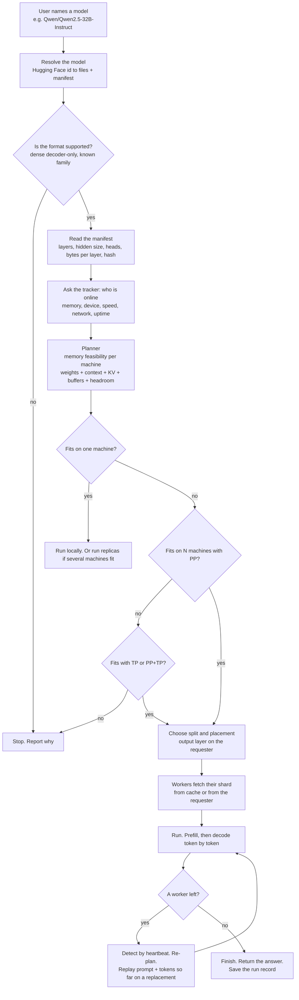

# Flow: a model arrives. What happens next

Draft for agreement with the supervisor (meeting of 2026-10-11, item "flow diagram"). Status: proposed. Short sentences by request.

## 1. The picture

## 2. The steps in words

1. **Name.** The user gives a model name. Hugging Face style, `owner/model`. Optionally a quantization.
2. **Resolve.** The requester maps the name to files and a manifest. See BACKGROUND_AND_DESIGN.md section 3.
3. **Check.** Unsupported architecture or format: stop and say why.
4. **Discover.** The tracker returns online workers and their profile. Until the tracker exists, a static `peers.toml` (ADR-008).
5. **Plan.** The planner counts memory per machine: weights, context (input plus output), KV cache, runtime buffers, headroom. It picks the smallest legal setup. One machine, replicas, PP, TP, or PP plus TP. Rule learned so far: keep the output layer on the requester.
6. **Load.** Each worker gets its shard. From its local cache if it has it. Otherwise from the requester.
7. **Run.** Prefill the prompt. Decode one token at a time. Each token crosses each machine boundary once.
8. **Survive.** Heartbeats. A lost worker triggers re-plan and replay. Nothing is emitted twice.
9. **Finish.** Return the answer. Save the command, placement and timing in the run folder.

## 3. What exists today, per step

| Step | State on 2026-10-17 |
|---|---|
| 1, 2 | Manual. A GGUF file path in `.env`. No name resolution yet |
| 3 | Manual. llama.cpp accepts or rejects the file |
| 4 | Manual. IP addresses typed on the command line |
| 5 | Manual `-ts`. Memory policy P1 or P2 in `scripts/10_capacity.sh`. No planner code |
| 6 | Works. llama.cpp RPC ships weights. Worker cache `-c` works (130 cache hits seen) |
| 7 | Works for PP on two Macs. TP on 32B failed once, unrecorded |
| 8 | Nothing. A lost worker kills the run |
| 9 | Works. Run folders under `experiments/` |

## 4. Open points for the supervisor

- Is this the agreed flow? What is missing?
- Step 5: should the planner prefer the fewest machines, or the most reliable ones?
- Step 8: is restart from the beginning enough for a first version, or must we continue mid-answer?
