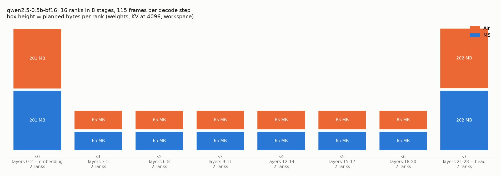
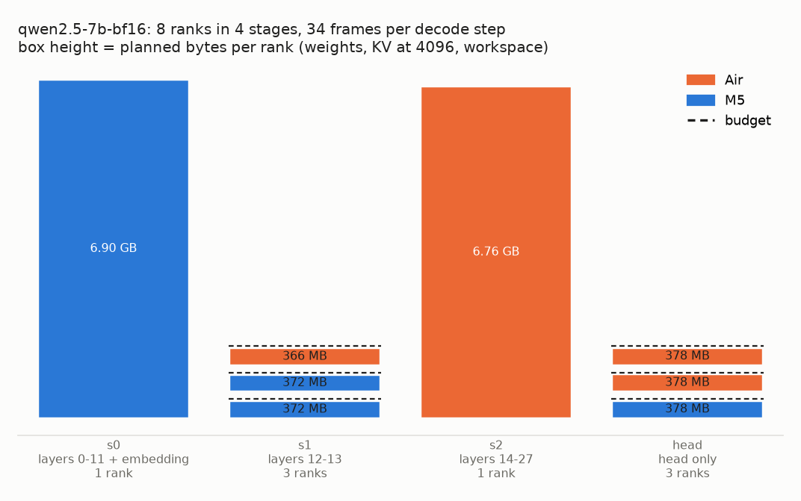
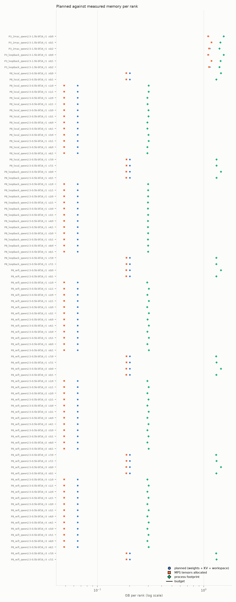
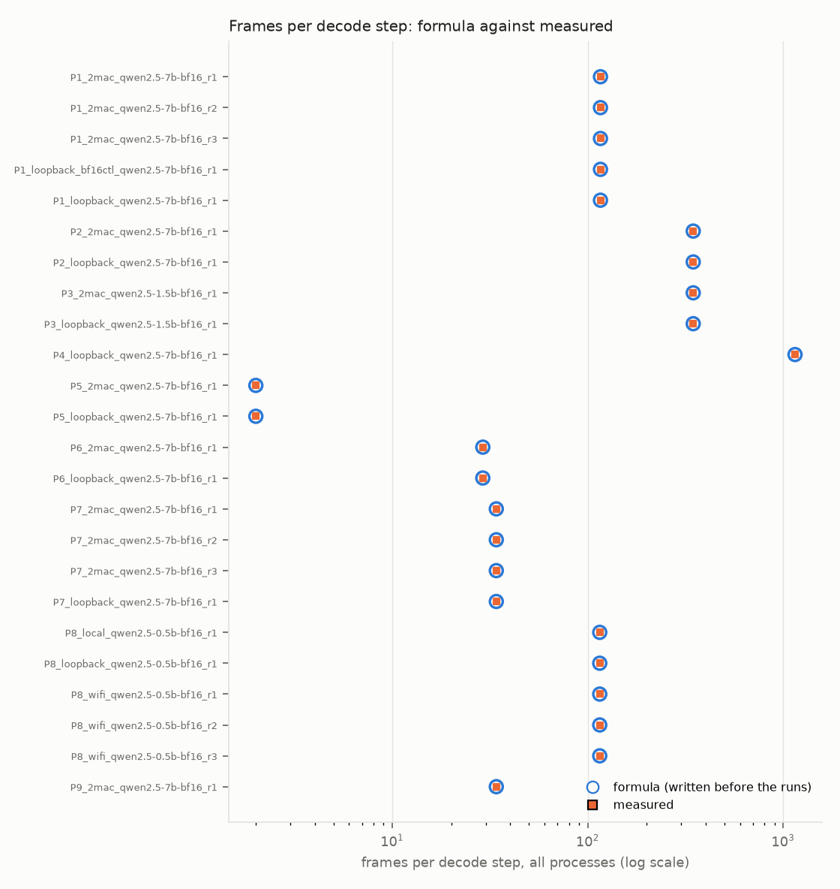

# השמה כללית: קבוצות לא שוות, שלבים של קבוצות, וצמתים קטנים משכבה

סיכום ניסויים, 15 בנובמבר 2026. המשך ישיר לסיכום "גבול הזיכרון של שתי מכונות".

## השאלה

בסיכום הקודם מצאנו שעל שתי המכונות שלנו הזיכרון לא מכריח חלוקה בתוך שכבה.
נשארה שאלה כללית יותר: האם אפשר לבנות כל צורה של חלוקה, ולסמוך על התכנון שלה?
חילקנו אותה לארבע שאלות מדידות:

1. האם חלוקה בתוך שכבה עובדת גם בחלקים לא שווים, ובקבוצה של 3 או 5 מכונות?
2. האם אפשר לשרשר שלבים, כשכל שלב הוא קבוצה בגודל אחר? כולל הצורה שאהד הציע: 8 שלבים, שבכל אחד זוג.
3. האם צומת חלש, שלא מחזיק אפילו שכבה אחת, יכול לתרום?
4. האם התכנון מדויק: הבתים שכל תהליך טוען, ומספר ההודעות ברשת בכל צעד?

## ההגדרות

- מנוע: המנוע שלנו ב-PyTorch. לא llama.cpp. שום דבר כאן אינו ראיה על llama.cpp.
- מכונות: M5 עם 24 GB, ו-MacBook Air M3 עם 16 GB. רשת Wi-Fi ביתית, VPN כבוי. מניעת שינה פעלה בשתי המכונות.
- גרסת PyTorch שונה: 2.14.1 ב-M5, 2.15.0 ב-Air.
- מודלים: Qwen2.5 Instruct בגדלים 0.5B, 1.5B ו-7B, ב-bf16 בלי דחיסה. אותו קובץ בשתי המכונות, נבדק לפי טביעת אצבע.
- מושגים:
  - **שלב**: טווח של שכבות שלמות. שלבים עוקבים הם חלוקה לפי שכבות.
  - **קבוצה**: כמה תהליכים שמחלקים ביניהם כל שכבה של השלב. זו חלוקה בתוך שכבה.
  - כל שלב הוא קבוצה. קבוצה של תהליך אחד היא שלב רגיל.
  - **תהליך**: חבר אחד בקבוצה. תהליך רץ על ה-GPU של המכונה או על ה-CPU שלה.
- ייחוס: אותו מודל בתהליך אחד, על ה-M5.
- הצלחה (נקבע לפני הריצות): בחירת הטוקן החמדנית זהה לייחוס בלפחות 7 מתוך 8 שאלות, עד 32 טוקנים, ואותו ציון נכונות.
- נמדד גם: פרומפט ארוך אחד של 256 טוקנים. רשמנו באיזה טוקן הפלט נפרד מהייחוס לראשונה. זה מספר לעיון, לא מבחן. גם הספרייה הרשמית (transformers) נפרדת מהמנוע שלנו על אותו פרומפט, בתוך 10 טוקנים.
- מהירות נרשמה אבל אינה מדד (החלטת צוות).

## איך המתכנן מחלק

המתכנן מקבל רשימת שלבים. לכל תהליך יש משקל יחסי, ואפשר לתת לו תקציב זיכרון.
מכאן הוא מחשב לכל תהליך בדיוק מה הוא מחזיק:

- ראשי הקשב נחלקים לפי המשקל. אפשר גם לקבוע אותם ביד.
- שורות שכבת ה-MLP משלימות כל תהליך לחלקו. החלוקה בצעדים של 128 שורות.
- גם טבלת ה-embedding וגם ראש הפלט נחלקים לפי שורות של אוצר המילים.
- אם גבול בין תהליכים נופל באמצע קבוצת ראשי KV, ראש ה-KV הזה נשמר בשני התהליכים. זה עולה מעט זיכרון (ראו "מה עולה קבוצה").
- כל תהליך שחורג מהתקציב נדחה לפני ההרצה, בשמו.

סכום החלקים בתוך קבוצה נעשה בסדר קבוע, ב-fp32, על ה-CPU. לכן כל התהליכים בקבוצה מחזיקים בדיוק אותו מצב.

## תשובה 1: קבוצות לא שוות, ובכל גודל. כן

| מודל | קבוצה | ראשי קשב לכל תהליך | עותקים של ראשי KV (במודל יש) | איפה | זהות | ריצות |
|---|---|---|---|---|---|---|
| 7B | 2, ביחס 3:2 | 17, 11 | 5 (4) | מק אחד | 8/8 | 1 |
| 7B | אותו דבר, סכום ב-bf16 | | | מק אחד | 8/8 | 1 |
| 7B | 2, ביחס 3:2 | 17, 11 | 5 (4) | M5 ו-Air | 8/8 | 3 |
| 7B | 3, ראשים לפי KV | 14, 7, 7 | 4 (4) | מק אחד | 8/8 | 1 |
| 7B | 3, ראשים לפי KV | 14, 7, 7 | 4 (4) | שניים ב-M5, אחד ב-Air | 8/8 | 1 |
| 1.5B | 3, שווה | 4, 4, 4 | 4 (2) | מק אחד | 8/8 | 1 |
| 1.5B | 3, שווה | 4, 4, 4 | 4 (2) | שניים ב-M5, אחד ב-Air | 8/8 | 1 |
| 7B | 5, שווה | 6, 6, 6, 5, 5 | 8 (4) | מק אחד | 8/8 | 1 |

ציון הנכונות שווה לייחוס בכל שורה.

### מה רואים

- כל גודל קבוצה וכל יחס עברו. גם כשיש בקבוצה יותר תהליכים מראשי KV (1.5B עם 3 תהליכים ו-2 ראשי KV, 7B עם 5 ו-4).
- שלוש הריצות על שתי המכונות זהות זו לזו. המנוע דטרמיניסטי.
- סכום ב-bf16 נתן בדיוק את מה שנתן סכום ב-fp32. בזוג זה מובטח: שני מספרי bf16 מתחברים ב-fp32 בלי שגיאה. ההבדל יכול להופיע רק בקבוצה של 3 ומעלה.
- בפרומפט הארוך הפלט נפרד מהייחוס בטוקן 49 עד 127. אין קשר לגודל הקבוצה: קבוצה של 5 החזיקה יותר מזוג.

## תשובה 2: שלבים של קבוצות. כן

| מודל | שלבים (תהליכים בכל שלב) | איפה | זהות | פרומפט ארוך: טוקן הפרידה | ריצות |
|---|---|---|---|---|---|
| 7B | 1, 1 (חלוקה לפי שכבות בלבד) | מק אחד | 8/8 | אין. כל 256 זהים | 1 |
| 7B | 1, 1 | M5, ואז Air | 8/8 | 72 | 1 |
| 7B | 1, 3, 1 | מק אחד | 8/8 | 49 | 1 |
| 7B | 1, 3, 1 | M5; קבוצה של שניים ב-M5 ואחד ב-Air; Air | 8/8 | 49 | 1 |
| 0.5B | 8 שלבים של זוגות, 16 תהליכים | מק אחד | 8/8 | 60 | 1 |
| 0.5B | 8 שלבים של זוגות, כל זוג חצוי בין המכונות | M5 ו-Air | 8/8 | 10 | 3 |
| 0.5B | 8 שלבים של זוגות, כל זוג על מכונה אחת, השלבים מתחלפים | M5 ו-Air | 8/8 | 10 | 1 |



גובה כל תיבה הוא הזיכרון המתוכנן לתהליך. כחול: M5. כתום: Air.

### מה רואים

- הצורה של אהד עובדת: 16 תהליכים, על מכונה אחת ועל שתיים, בשני הסידורים.
- השלב הראשון והאחרון כבדים פי שלושה מהשאר. הם מחזיקים גם את טבלת ה-embedding ואת ראש הפלט. במודל הזה הם אותה טבלה, והיא נטענת פעמיים.
- חלוקה לפי שכבות בלבד, על מכונה אחת, זהה לייחוס ביט לביט. כל 256 הטוקנים זהים. המעבר בין שלבים לא מאבד דבר.
- אותה חלוקה בדיוק, כשהשלב השני רץ על ה-Air, נפרדת בטוקן 72. אין שם שום חלוקה בתוך שכבה. כלומר ה-Air מחשב אחרת מה-M5.
- השערה: ה-GPU השונה או גרסת PyTorch השונה. לא בדקנו מה מהשניים.

## תשובה 3: צומת קטן משכבה. כן, עם סייג חשוב

התצורה (ה-7B):

- שלב ראשון: שכבות 0 עד 11 וה-embedding, על ה-M5.
- שלב שני: שכבות 12 ו-13, בקבוצה של שלושה תהליכים חלשים. שניים ב-M5, אחד ב-Air.
- שלב שלישי: שכבות 14 עד 27, על ה-Air.
- שלב אחרון: ראש הפלט בלבד, בקבוצה של שלושה תהליכים חלשים. אחד ב-M5, שניים ב-Air.

לכל תהליך חלש תקציב של 0.40 GB. שכבה אחת של 7B היא 0.466 GB. ראש הפלט 1.09 GB. כלומר אף תהליך חלש לא יכול להחזיק יחידה שלמה.



הקו המקווקו הוא התקציב של כל תהליך חלש.

| ניסוי | תוצאה | זיכרון מתוכנן לתהליך חלש | זיכרון בפועל לתהליך חלש |
|---|---|---|---|
| התצורה, על מק אחד | עבר, 8/8 | 0.32 עד 0.37 GB | 1.26 עד 1.29 GB |
| התצורה, על שתי המכונות | עבר, 3 מתוך 3 ריצות, 8/8 | 0.32 עד 0.37 GB | 1.28 עד 1.37 GB |
| התצורה, כשהתהליכים החלשים על ה-CPU | עבר, 8/8 | 0.32 עד 0.37 GB | 0.16 עד 0.18 GB |
| אותם צמתים, חלוקה לפי שכבות בלבד | המתכנן דוחה, ומציין שלושה תהליכים בשמם | 0.59 GB ו-1.11 GB | |
| אותו דבר, כשעוקפים את המתכנן | נכשל בטעינה, בדיוק בשלושת התהליכים האלה | | |
| התצורה, עם מגבלת הזיכרון של PyTorch בגובה התקציב | נכשל בטעינה, בכל ששת התהליכים החלשים | | |

### מה רואים

- צומת שלא מחזיק שכבה אחת יכול לתרום כחבר בקבוצה. הפלט נכון בארבע ריצות.
- המתכנן והטעינה מסכימים. המתכנן מצביע על שלושה תהליכים. הריצה הכפויה נכשלת בדיוק בהם, בטנזור הראשון שחוצה את התקציב.
- **הסייג:** ב-GPU של אפל, דרך PyTorch, תהליך חלש תופס בפועל כ-1.3 GB. זה פי שלושה מהתקציב.
- הסיבה: PyTorch שם כל טנזור של 10 MiB ומעלה בבלוק זיכרון של 1 GiB. הבלוק הזה תופס זיכרון אמיתי. לכל תהליך חלש יש לפחות טנזור אחד כזה.
- מגבלת הזיכרון של PyTorch סופרת את הבלוק הזה. לכן היא דוחה גם את התצורה החוקית.
- על ה-CPU אין בלוק כזה. שם התהליך החלש תופס פחות מהתקציב, כי המשקלים נשארים ממופים מהקובץ.

### המשמעות למתנדבים

מחשב נייד עם מעט זיכרון פנוי יכול להצטרף לקבוצה ולהחזיק חלק מיחידה שגדולה ממנו.
דרך ה-GPU של אפל, הכניסה עולה כ-1.3 GB לתהליך. כמתנדב CPU היא עולה את חלקו ועוד כ-0.15 GB.

## תשובה 4: האם התכנון מדויק. כן, בבתים ובהודעות

### בתים

בכל תהליך, בכל ריצה שהושלמה, הבתים שנטענו שווים בדיוק לבתים שהמתכנן חישב. 167 מופעים של תהליך ב-30 ריצות.



עיגול כחול: מה שהמתכנן חישב. ריבוע כתום: הטנזורים ב-GPU. מעוין ירוק: מה שהתהליך תופס בפועל. קו שחור: התקציב.

- הריבוע יושב ליד העיגול. ההפרש הוא מאגר העבודה שהמתכנן מוסיף כהערכה.
- המעוין הוא הסיפור. תהליך שכל הטנזורים שלו קטנים מ-10 MiB תופס את חלקו ועוד כ-0.25 GB. תהליך עם טנזור גדול אחד תופס לפחות כ-1.3 GB.
- תהליך ריק, לפני טעינה, תופס 0.20 עד 0.23 GB.

### הודעות ברשת

כתבנו נוסחה למספר ההודעות בכל צעד, לפני הריצות. היא שווה למדידה בכל 24 ריצות ההשמה.

```
frames = (n_0 - 1) + n_0 (n_0 - 1)  +  sum over stages of 2 L_s n_s (n_s - 1)  +  sum over hops of n_next  +  (n_head - 1 or n_head)
         token        embedding        two all-reduces per layer                  stage hops                head
```

כאן `n_s` הוא מספר התהליכים בשלב, ו-`L_s` מספר השכבות בו.

- בקבוצה של `n` תהליכים, כל סכום עולה `n(n-1)` הודעות. יש שני סכומים בכל שכבה.
- זוג עולה 4 הודעות לשכבה. קבוצה של 5 עולה 40.
- ב-7B: חלוקה לפי שכבות בלבד עולה 2 הודעות לצעד. זוג עולה 116. קבוצה של 3 עולה 346. קבוצה של 5 עולה 1148.



### מפתח לתוויות בגרפים

| תווית | התצורה |
|---|---|
| P1 | 7B, זוג ביחס 3:2 |
| P2 | 7B, קבוצה של 3 עם ראשים לפי KV |
| P3 | 1.5B, קבוצה של 3 |
| P4 | 7B, קבוצה של 5 |
| P5 | 7B, שני שלבים, חלוקה לפי שכבות בלבד |
| P6 | 7B, שלבים של 1, 3, 1 |
| P7 | 7B, צמתים חלשים בתוך קבוצות |
| P8 | 0.5B, 8 שלבים של זוגות |
| P9 | כמו P7, התהליכים החלשים על ה-CPU |
| loopback, one Mac | הכל על ה-M5 |
| 2mac, two Macs, wifi, local | על שתי המכונות |

## מה עולה קבוצה

בזיכרון, קבוצה לא שווה עולה מעט. כשגבול נופל באמצע קבוצת ראשי KV, ראש ה-KV נשמר פעמיים.

| קבוצה ב-7B | עותקים של ראשי KV (במודל יש 4) | תוספת משקלים לשכבה | תוספת KV ב-4096 טוקנים, לכל המודל |
|---|---|---|---|
| 17, 11 ראשים | 5 | 1.8 MB | 59 MB |
| 10, 9, 9 ראשים (מחושב, לא הורץ) | 6 | 3.7 MB | 117 MB |
| 6, 6, 6, 5, 5 ראשים | 8 | 7.3 MB | 235 MB |
| 14, 7, 7 ראשים (לפי KV) | 4 | 0 | 0 |

שכבה של 7B היא 466 MB. גם בקבוצה של 5 התוספת קטנה מ-2 אחוז. חלוקת ראשים לפי גבולות ה-KV מבטלת אותה.

ברשת, קבוצה עולה הרבה. מספר ההודעות גדל כריבוע של גודל הקבוצה.

## הכלל הכללי

- קבוצה נחוצה כשיחידה אחת גדולה מהצומת שאמור להחזיק אותה. יחידה היא שכבה, טבלת ה-embedding, או ראש הפלט.
- אז היחידה מתחלקת בין חברי קבוצה, וכל צומת מקבל חלק.
- בכל מקרה אחר, חלוקה לפי שכבות שלמות מספיקה, וזולה בהרבה ברשת.
- קבוצה קטנה עדיפה. זוג עולה 4 הודעות לשכבה, קבוצה של 5 עולה 40.
- כשאפשר, לחלק ראשים לפי גבולות ה-KV.
- ב-GPU של אפל דרך PyTorch, צומת חלש עולה בפועל max(חלקו, כ-1.3 GB). זה יכנס לקוד ההשמה כל עוד המשקלים לא מחולקים לטנזורים קטנים מ-10 MiB.

זה מתיישב עם הסיכום הקודם. על שתי המכונות שלנו, ובמודלים צפופים עד 32B, אף יחידה לא גדולה ממכונה. לכן שם לא נדרשה קבוצה. הקבוצה נחוצה לצמתים קטנים: מחשבים ניידים עם מעט זיכרון פנוי.

## קשיים בדרך

| קושי | מה קרה | מה תוקן |
|---|---|---|
| ה-M5 נכנס להחלפה לדיסק | ריצת הייחוס של 7B נתקעה כשהיו פתוחות אפליקציות רבות | אהד סגר אפליקציות. הריצה נעצרה וסומנה. ריצה חדשה עברה |
| שני עותקים של המודל | הבדיקה מול הספרייה הרשמית טענה עותק שני של 7B, בזמן שהעותק של המנוע עוד היה בזיכרון | כלי ההרצה משחרר את המנוע לפני הבדיקה. הריצה נעצרה וסומנה, וריצה חדשה עברה |
| באג אחרי ריצה טובה | ריצת ייחוס של 0.5B הסתיימה ואז נפלה בשמירה | תוקן, והריצה חזרה. שום מספר לא נלקח מהריצות שנעצרו |
| מגבלת הזיכרון של PyTorch | היא דוחה תקציב חוקי מתחת לכ-1.07 GB, בגלל בלוק ה-1 GiB | התקציב נאכף על בתי הטנזורים: במתכנן, בטעינה וב-KV. לצדו מדווח הזיכרון בפועל |
| תצורת הצמתים החלשים על מק אחד | 8 תהליכים תפסו 23.2 GB, על מכונה של 24 GB. המכונה עברה להחלפה לדיסק | הריצה הסתיימה עם פלט נכון, לאט. ריצות חוזרות נעשו על שתי המכונות |

## מה לא נבדק

- מהירות. אינה מדד.
- פרומפטים ארוכים מ-256 טוקנים.
- יותר מפרומפט ארוך אחד לכל מודל.
- שיא הזיכרון בתוך צעד. הזיכרון נמדד אחרי הריצה.
- אותה גרסת PyTorch בשתי המכונות. בלי זה לא ניתן להפריד בין GPU לגרסה בסטייה בין המכונות.
- תקציב אחר מ-0.40 GB, ומודל אחר בתצורת הצמתים החלשים.
- חלוקת משקלים לטנזורים קטנים מ-10 MiB. זה מה שיכול להוריד את עלות הצומת החלש.
- המכונה עם NVIDIA, אינטרנט בין בתים, מודלי MoE, משקלים דחוסים.
- רוב התצורות רצו פעם אחת. חוזרות: זוג 3:2 על שתי המכונות (3), הצמתים החלשים על שתי המכונות (3), 8 זוגות חצויים בין המכונות (3).

## צעדים מוצעים

1. אותה גרסת PyTorch בשתי המכונות, וחזרה על חלוקה לפי שכבות בלבד בין המכונות. כך נדע אם הסטייה מה-GPU או מהגרסה.
2. תצורת הצמתים החלשים, כשהמשקלים שלהם מחולקים לטנזורים קטנים מ-10 MiB. תחזית: זיכרון בפועל של החלק ועוד כ-0.25 GB, ופלט זהה.
3. בקוד ההשמה: עלות של צומת GPU של אפל היא max(חלקו, כ-1.3 GB). העדפה לקבוצות קטנות ולחלוקת ראשים לפי KV.

<details>
<summary>נספח: מזהי ריצות</summary>

כל המזהים והמספרים נמצאים ב-`experiments/session6_hybrid/HYBRID_TABLE.md` ובבלוק "Session 6, hybrid placement, 2026-11" ב-`experiments/RESULTS.md`. הניתוח המלא באנגלית: `experiments/session6_hybrid/REPORT.md`. התחזיות שנכתבו לפני הריצות: `experiments/session6_hybrid/PREDICTIONS.md`. קבצי התצורה: `experiments/session6_hybrid/placements/`.

ייחוס:

- 7B על ה-GPU: `R0_qwen2.5-7b-bf16_mps_r3`
- 7B על ה-CPU: `R0_qwen2.5-7b-bf16_cpu_r1`
- 1.5B: `R0_qwen2.5-1.5b-bf16_mps_r1`, `R0_qwen2.5-1.5b-bf16_cpu_r1`
- 0.5B: `R0_qwen2.5-0.5b-bf16_mps_r2`, `R0_qwen2.5-0.5b-bf16_cpu_r1`
- נעצרו, בלי נתונים בשימוש: `R0_qwen2.5-7b-bf16_mps_r1`, `R0_qwen2.5-7b-bf16_mps_r2`, `R0_qwen2.5-0.5b-bf16_mps_r1`

תשובה 1:

- זוג 3:2: `P1_loopback_qwen2.5-7b-bf16_r1`, `P1_loopback_bf16ctl_qwen2.5-7b-bf16_r1`, `P1_2mac_qwen2.5-7b-bf16_r1` עד `_r3`
- קבוצה של 3, 7B: `P2_loopback_qwen2.5-7b-bf16_r1`, `P2_2mac_qwen2.5-7b-bf16_r1`
- קבוצה של 3, 1.5B: `P3_loopback_qwen2.5-1.5b-bf16_r1`, `P3_2mac_qwen2.5-1.5b-bf16_r1`
- קבוצה של 5: `P4_loopback_qwen2.5-7b-bf16_r1`

תשובה 2:

- לפי שכבות בלבד: `P5_loopback_qwen2.5-7b-bf16_r1`, `P5_2mac_qwen2.5-7b-bf16_r1`
- שלבים 1, 3, 1: `P6_loopback_qwen2.5-7b-bf16_r1`, `P6_2mac_qwen2.5-7b-bf16_r1`
- 8 זוגות: `P8_loopback_qwen2.5-0.5b-bf16_r1`, `P8_wifi_qwen2.5-0.5b-bf16_r1` עד `_r3`, `P8_local_qwen2.5-0.5b-bf16_r1`

תשובה 3:

- צמתים חלשים: `P7_loopback_qwen2.5-7b-bf16_r1`, `P7_2mac_qwen2.5-7b-bf16_r1` עד `_r3`
- על ה-CPU: `P9_2mac_qwen2.5-7b-bf16_r1`
- המתכנן דוחה: `P7ctl_2mac_qwen2.5-7b-bf16_r1`
- עקיפת המתכנן: `P7ctl_2mac_forced_qwen2.5-7b-bf16_r1`
- עם מגבלת הזיכרון של PyTorch: `P7_2mac_mpscap_qwen2.5-7b-bf16_r1`

</details>
