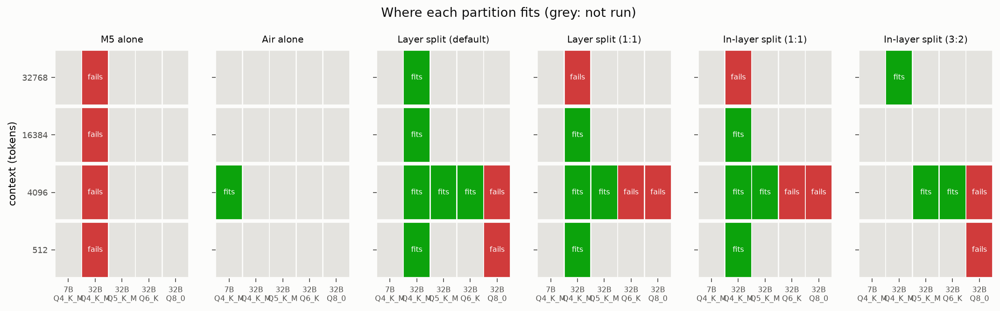
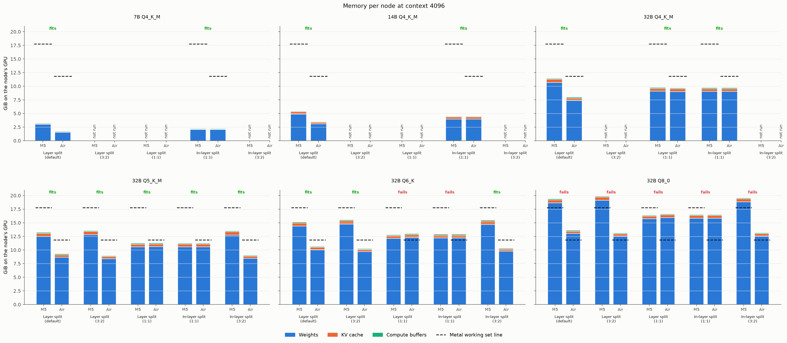
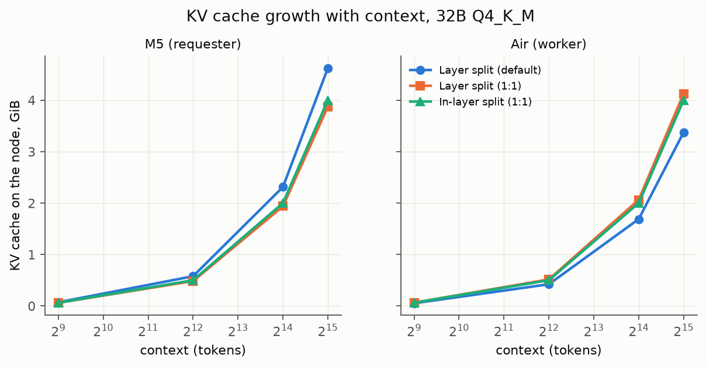
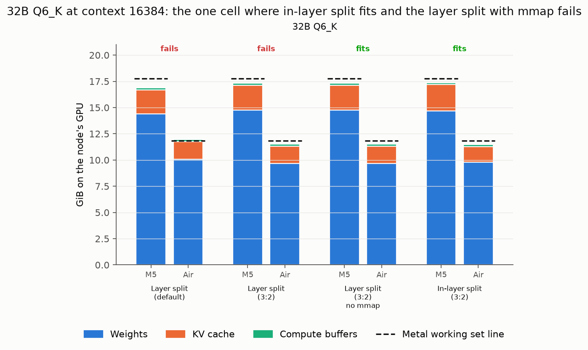

# גבול הזיכרון של שתי מכונות: מתי חלוקה לפי שכבות מספיקה

סיכום ניסויים, 7 עד 14 בנובמבר 2026. מענה למשימה מהפגישה ב-2.11: תוצאות, קשיים, מדידות וגרפים.

## השאלה

השאלה מהפגישה: מתי חלוקה לפי שכבות מספיקה, ומתי הזיכרון מכריח חלוקה בתוך שכבה?
חילקנו אותה לשלוש שאלות מדידות:

1. מה המודל הגדול ביותר, ובאיזה אורך הקשר, שרץ בכל סוג חלוקה?
2. מה ממלא את הזיכרון בכל מכונה בגבול: משקלים, מטמון KV, או מאגרי חישוב?
3. האם יש מודל ואורך הקשר שבהם חלוקה בתוך שכבה מצליחה וחלוקה לפי שכבות נכשלת?

## ההגדרות

| | M5 | MacBook Air M3 |
|---|---|---|
| זיכרון | 24 GB | 16 GB |
| תפקיד | מבקש (llama-server) | עובד (ggml-rpc-server) |
| קו העבודה של Metal, כפי שהמנוע מדווח | 17.76 GiB | 11.84 GiB |

- מנוע: llama.cpp בגרסה `1e7bcf3`. רשת Wi-Fi ביתית, VPN כבוי.
- מודלים: Qwen2.5 Instruct בגדלים 7B, 14B ו-32B. את 32B הרצנו בארבע רמות דחיסה: Q4_K_M, Q5_K_M, Q6_K ו-Q8_0. רמה גבוהה יותר = קובץ גדול יותר ואיכות גבוהה יותר.
- אורכי הקשר: 512, 4096, 16384 ו-32768 טוקנים.
- סוגי חלוקה:
  - חלוקה לפי שכבות: כל מכונה מקבלת שכבות שלמות. היחס נקבע בדגל `-ts`.
  - חלוקה בתוך שכבה: כל שכבה מתחלקת בין שתי המכונות.
  - היחסים שנבדקו: ברירת המחדל של המנוע, 3:2 לטובת ה-M5, ו-1:1.
- מהירות נרשמה אבל אינה מדד הצלחה (החלטת צוות). הצלחה = נטען, ענה על כל השאלות, ותשובות זהות לריצת הייחוס.
- כל מספר זיכרון כאן נלקח מהשורות שהמנוע עצמו מדפיס.

## מה נכנס לאן

| מודל | אורך הקשר | M5 לבד | Air לבד | לפי שכבות, ברירת מחדל | לפי שכבות, 3:2 | לפי שכבות, 1:1 | בתוך שכבה, 1:1 | בתוך שכבה, 3:2 |
|---|---|---|---|---|---|---|---|---|
| 7B Q4_K_M | 32768 | נכנס | נכנס | נכנס | | | נכנס | |
| 14B Q4_K_M | 4096 | נכנס | נכנס | נכנס | | | נכנס | |
| 14B Q4_K_M | 32768 | נכנס | **לא** | נכנס | | | נכנס | |
| 32B Q4_K_M | 512 עד 16384 | **לא** | | נכנס | | נכנס | נכנס | |
| 32B Q4_K_M | 32768 | **לא** | | נכנס | נכנס | **לא** | **לא** | נכנס |
| 32B Q5_K_M | 4096 | | | נכנס | נכנס | נכנס | נכנס | נכנס |
| 32B Q6_K | 4096 | | | נכנס | נכנס | **לא** | **לא** | נכנס |
| 32B Q6_K | 16384 | | | **לא** | נכנס בלי mmap (ראו למטה) | | | נכנס |
| 32B Q6_K | 32768 | | | | | | | **לא** |
| 32B Q8_0 | 4096 (וב-512: שלוש חלוקות) | | | **לא** | **לא** | **לא** | **לא** | **לא** |

תא ריק = לא הורץ, כי התוצאה נקבעת מתא קטן יותר.

### מה רואים

- אף מכונה לבד לא מריצה 32B. ה-M5 נכשל כבר ב-512 טוקנים: המשקלים לבד הם 18.08 GiB, מעל הקו.
- שתי המכונות יחד מריצות 32B Q4_K_M עד 32768 טוקנים, ו-32B Q6_K עד 16384 טוקנים.
- 32B Q8_0 לא נכנס בשום חלוקה. גם לא ב-512 טוקנים. המשקלים גדולים מסך הזיכרון של שתי המכונות.
- כל ריצה שהצליחה ענתה נכון על השאלות הנבדקות. ב-7B וב-14B התשובות זהות לריצה על מכונה אחת. ב-32B אין ריצה על מכונה אחת, לכן השווינו לחלוקה לפי שכבות באותו אורך הקשר: זהות בכל התאים.

## מה ממלא את הזיכרון

- המשקלים הם רוב הזיכרון: 80 עד 95 אחוז בכל מכונה בגבול.
- מטמון KV גדל בקו ישר עם אורך ההקשר. ב-32B הוא בדיוק 256 MiB לכל 1000 טוקנים, בשתי המכונות יחד.
- מאגרי החישוב קטנים: 0.18 עד 0.23 GiB. הם כמעט לא גדלים עם אורך ההקשר.
- בחלוקה בתוך שכבה המנוע לא משכפל דבר. באותו יחס, כל מכונה מחזיקה כמעט בדיוק את מה שהיא מחזיקה בחלוקה לפי שכבות. ההפרש קטן מ-0.06 GiB.
- הכישלון נקבע לפי סכום הזיכרון בכל מכונה מול הקו שלה. הכלל הזה צדק ב-60 מתוך 61 תאים. החריג היחיד מוסבר בסעיף הבא.

## התשובה לשאלה השלישית: לא

לא מצאנו מודל ואורך הקשר שבהם רק חלוקה בתוך שכבה עובדת.

היה תא אחד שנראה כך: 32B Q6_K ב-16384 טוקנים.

| חלוקה | ריצות שהצליחו | מקום פנוי ב-M5 | מקום פנוי ב-Air |
|---|---|---|---|
| לפי שכבות, ברירת מחדל | 0 מתוך 2 | 0.87 GiB | חסרים 0.10 GiB |
| לפי שכבות, 3:2, טעינה רגילה | 0 מתוך 3 | 0.44 GiB | 0.33 GiB |
| לפי שכבות, 3:2, בלי mmap | 2 מתוך 2 | 0.44 GiB | 0.33 GiB |
| בתוך שכבה, 3:2 | 3 מתוך 3 | 0.38 GiB | 0.36 GiB |

מה קרה:

1. בברירת המחדל ה-Air קיבל שכבה אחת יותר מדי. חסרו לו 0.10 GiB.
2. ביחס 3:2 השכבה עברה ל-M5. הסכום נכנס בשתי המכונות. ובכל זאת ה-M5 נכשל בכל פעם, בהרצת החימום הראשונה.
3. ההבדל היחיד שמצאנו ביומנים: בחלוקה לפי שכבות המבקש ממפה את קובץ המודל ישירות לזיכרון (mmap). בחלוקה בתוך שכבה הוא מעתיק את המשקלים למאגר משלו.
4. הרצנו שוב את 3:2 עם הדגל `--load-mode none`, שמבטל את המיפוי. אותם גדלי מאגרים בדיוק. הריצה הצליחה פעמיים, עם תשובות זהות לחלוקה בתוך שכבה.

המסקנה: את התא הזה קבע אופן הטעינה של המנוע, לא סוג החלוקה.

השלכה לקוד ההשמה: כשלמבקש נשאר פחות מבערך 2 GiB פנויים, להפעיל אותו עם `--load-mode none`.

מגבלה: לא מדדנו כמה זיכרון המיפוי עולה. ידוע רק שהוא יותר מ-0.44 GiB ופחות מ-2.23 GiB בתנאים האלה.

## כלל המעבר

סימונים:

- `C` הוא הקו של מכונה. `W` המשקלים. `K` מטמון KV. `B` מאגר החישוב.
- מרווח הזוג: `S = C_M5 + C_Air - (W + K + 2B)`.
- שכבה אחת עולה `u = w_layer + k_layer`. ב-32B זה 0.28 עד 0.51 GiB, לפי הדחיסה ואורך ההקשר.

הכלל:

- אם `S < 0`, שום חלוקה לא נכנסת. חסר זיכרון כולל.
- אם `S >= u`, חלוקה לפי שכבות נכנסת. חלון האפשרויות רחב משכבה אחת, ולכן יש בו גבול שכבה.
- אם `0 <= S < u`, ייתכן שרק חלוקה בתוך שכבה נכנסת. זה האזור היחיד שבו היא נחוצה מסיבת זיכרון.

בדקנו את הכלל מול כל שילוב של מודל ואורך הקשר. הוא צדק בכולם. אף שילוב לא נפל באזור שבו נחוצה חלוקה בתוך שכבה. הקרוב ביותר: 32B Q6_K ב-16384 טוקנים, עם מרווח 0.77 GiB ושכבה של 0.45 GiB.

חשבון למודלים גדולים יותר (לא נמדד):

- מודל צפוף בגודל 70B: שכבה אחת היא בערך 0.5 GiB ב-Q4. שכבת הפלט בערך 1 GiB. שתיהן קטנות בהרבה מ-11.84 GiB של ה-Air. שכבה בודדת לא תכריח חלוקה בתוך שכבה.
- המודל כולו הוא בערך 40 GiB. זה יותר מ-29.6 GiB של שתי המכונות. כלומר הוא צריך מכונה שלישית, לא חלוקה אחרת.
- מודלי MoE לא נבדקו. שכבת מומחים של מודל בסדר גודל 600B היא בערך 6 GiB ב-Q4. היא עדיין נכנסת ל-Air, אבל עם מעט מקום ל-KV.

### התשובה לשאלה מהפגישה

על שתי מכונות מהסוג שלנו, הזיכרון לא הכריח חלוקה בתוך שכבה עבור מודלים צפופים עד 32B.
החלוקה בתוך שכבה היא כלי לחלוקה עדינה יותר. היא יכולה לעזור רק כשהמרווח קטן משכבה אחת. זה לא קרה.
מה שקבע הצלחה או כישלון: סך הזיכרון, והתאמת היחס לגודל המכונות. יחס 1:1 על מכונה של 24 GB ומכונה של 16 GB נכשל בשתי שיטות החלוקה באותם תאים.

## מכונה שלישית: לאיזה כיוון (חשבון, לא מדידה)

כל כישלון כאן הוא אחד משניים: חסר זיכרון כולל, או יחס שלא מתאים לגודל המכונות.
אף כישלון לא נבע משכבה שגדולה ממכונה.
לכן מכונה שלישית תעזור כשלב נוסף בחלוקה לפי שכבות, שמוסיף זיכרון.
זוג שמחלק שכבה בתוכו שווה משהו רק אם שכבה אחת לא נכנסת למכונה. המודלים שבדקנו רחוקים מזה.

## קשיים בדרך

| קושי | מה קרה | מה תוקן |
|---|---|---|
| ה-Air נרדם | ב-8.11 ה-Air נכנס לשינה אחרי דקה בלי פעילות, באמצע הניסויים. 12 ריצות רצו בלי עובד | כלי ההרצה מונע שינה בשני המקים ובודק שה-Air עונה לפני כל ריצה. הריצות האלה הוצאו מהטבלה |
| הדיסק של ה-Air התמלא | העובד שומר במטמון על הדיסק כל משקל שהוא מקבל. המטמון הגיע ל-63 GB | כלי ההרצה מנקה את המטמון כשנשארים פחות מ-25 GB. זה משפיע רק על זמן הטעינה |
| מקום בדיסק להורדות | שלושת הקבצים של 32B תופסים 85 GB | הקובץ הגדול (Q8_0) נמחק מה-Air אחרי בדיקת התאמה. העובד לא קורא את הקובץ |
| מספר אחד לחלוקה בתוך שכבה | המנוע מדפיס שורת זיכרון אחת למבקש בלבד | חישבנו את חלק ה-Air לפי היחס. בדקנו פעם אחת מול כמות הנתונים שה-Air קיבל |
| כישלון שנראה כמו תוצאה | 3:2 לפי שכבות נכשל שלוש פעמים ב-32B Q6_K | ריצת בדיקה בלי mmap הראתה שהסיבה היא אופן הטעינה |

## מה לא נבדק

- שיא הזיכרון בפועל. כל המספרים הם ההקצאות שהמנוע מדווח.
- כמה עולה המיפוי לזיכרון (mmap).
- כיוון הפוך: ה-Air כמבקש.
- רשת קווית, Tailscale, שני בתים.
- זיכרון לכל מכונה במנוע ה-PyTorch שלנו, ומודל 14B בו (נדחה בגלל מקום בדיסק).
- מודלי MoE.
- אורכי הקשר בין ארבע הנקודות שנבדקו.
- רוב התאים בקבוצות 2 ו-4 רצו פעם אחת.

נספח: מזהי ריצות

כל המזהים, התאים והמספרים נמצאים ב-`experiments/session5_memory_edge/EDGE_TABLE.md` ובבלוק "Session 5, memory edge, 2026-11" ב-`experiments/RESULTS.md`. הניתוח המלא באנגלית: `experiments/session5_memory_edge/REPORT.md`.

התאים שמכריעים:

- M5 לבד נכשל ב-32B: `BASELINE_local_qwen2.5-32b-q4km_m5_c512_r2`
- Air לבד נכשל ב-14B ב-32768: `BASELINE_local_qwen2.5-14b-q4km_air_c32768_r1`
- 32B Q4_K_M ב-32768, לפי שכבות: `A1_wifi_qwen2.5-32b-q4km_m5_c32768_r1` עד `_r3`
- 32B Q4_K_M ב-32768, 1:1 נכשל: `A1_wifi_qwen2.5-32b-q4km_m5_c32768bal_r1` עד `_r3`, `B1_wifi_qwen2.5-32b-q4km_m5_c32768_r1`
- 32B Q6_K ב-16384, לפי שכבות: `A1_wifi_qwen2.5-32b-q6k_m5_c16384_r1`, `_r2`, `A1_wifi_qwen2.5-32b-q6k_m5_c16384prop_r1` עד `_r3`
- 32B Q6_K ב-16384, בלי mmap: `A1_wifi_qwen2.5-32b-q6k_m5_c16384propnommap_r1`, `_r2`
- 32B Q6_K ב-16384, בתוך שכבה: `B1_wifi_qwen2.5-32b-q6k_m5_c16384prop_r1` עד `_r3`
- 32B Q8_0 נכשל: `A1_wifi_qwen2.5-32b-q8_m5_c512_r1`, `B1_wifi_qwen2.5-32b-q8_m5_c512prop_r1`

