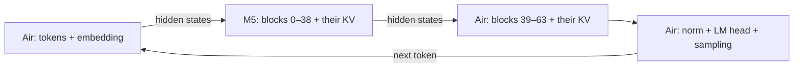

# איך מחלקים מודל שפה בין מחשבים — מדריך להבנה ולתכנון

**מצב (25.10.2026):** מדריך הסבר מפורט. הגרסה הקצרה והפורמלית, לפי בקשת המנחה, היא docs/BACKGROUND_AND_DESIGN.md. הטבלאות המספריות כאן מחושבות ולא נמדדו, אלא אם נכתב אחרת.

**עודכן:** 11.10.2026 · **גרסה:** 2, לאחר בקרת Codex על הטיוטה של Claude.

**מטרת המסמך:** להבין מה מחלקים, מי מחשב מה, מה עובר ברשת ואיך בוחרים תכנית. זהו מסמך הסבר ומועמדים לתכנון; הוא אינו מכריע את ADR-007 או מחליף מדידות.

**מסלול קריאה:** להבנה ראשונה — סעיפים 1–3 ו־8. לחישובי זיכרון ותעבורה — 4–6. למימוש ב־PyTorch — 7. תוצאות הניסויים המלאות נמצאות ב־[סיכום המצב](STATUS_2026-10-11.md); ביקורת הנתונים ב־I014–I015 שב[מסמך המשותף](SHARED_RESEARCH_AND_DECISIONS.md).

לאורך המסמך: **נמדד** = נתון מהניסויים שלנו; **מחושב** = נוסחה והנחות מפורשות; **מועמד** = רעיון שהמתכנן צריך לבדוק. מספר מחושב אינו תוצאת ניסוי.

## 1. התמונה בחמש דקות

מודל הוא סדרת חישובים. אפשר לחלק את **השלבים**, לחלק את **החישוב בתוך שלב**, או להשאיר עותקים מלאים ולחלק ביניהם **בקשות**.

| דרך | מה עושה כל מחשב? | מה היא עשויה לתת? | המחיר המרכזי |
|---|---|---|---|
| **מחשב יחיד** | מריץ את כל המודל | בסיס פשוט לבקשה אחת | מוגבל בזיכרון ובתפוקה שלו |
| **Replicas — עותקים עצמאיים** | מריץ מודל מלא עבור בקשות אחרות | יותר בקשות במקביל | משקולות מלאות בכל עותק; אינו מגדיל קיבולת לבקשה יחידה |
| **PP — חלוקת שכבות** | מריץ רצף בלוקים, ומעביר תוצאת ביניים לשלב הבא | צירוף זיכרון; לעיתים שיפור תפוקה עם כמה בקשות | תלות סדרתית והעברת תוצאות בין שלבים |
| **TP — חלוקה בתוך שכבה** | מחשב חלק מהפעולות באותו בלוק ובאותו טוקן | צירוף זיכרון ואפשרות להאצת חישוב טוקן | פעולות תקשורת משותפות חוזרות בתוך כל בלוק |
| **CP — חלוקת הקשר** | מחזיק/מעבד חלק מהטוקנים וה־KV שלהם | טיפול בהקשרים ארוכים וב־KV גדול | תקשורת לצורך attention על ההקשר המבוזר |

אפשר לשלב PP ו־TP, ואפשר להחזיק כמה עותקים של **מודל שכבר מחולק**. SP אינו שם נרדף מדויק ל־CP — ההבדל מוסבר בסעיף 3.4. חלוקה לפי מומחים ב־MoE היא ציר נוסף, מחוץ להיקף הנוכחי.

**מה זה אומר אצלנו:** ב־pilot של 7B, עותקים עצמאיים ניצחו בתפוקה; ב־32B, חלוקת שכבות אפשרה offload מלא שלא הצליח בריצות המקומיות. אלה שתי תועלות שונות — שירות לעוד בקשות לעומת הרצת מודל גדול יותר. אין עדיין מדידת TP מוצלחת שמכריעה את התאמתו לחומרה שלנו.

## 2. מה נמצא בתוך המודל, ואיפה רואים את החלוקה?

```text
token IDs → Embedding → Block 0 → Block 1 → … → Block L−1 → Norm → LM head → logits → sampling
```

- **Embedding:** הופך מזהה טוקן לווקטור מספרים.
- **בלוק Transformer:** משלב attention ו־MLP, עם normalization וחיבורי residual. ב־Qwen שנבדק המבנה חוזר, אבל המשקולות שונות בכל בלוק. במשפחות אחרות גם מבנה הבלוקים יכול להשתנות.
- **Hidden state:** תוצאת הביניים שעוברת בין הבלוקים.
- **LM head ו־logits:** חישוב ציון לכל טוקן באוצר המילים; sampling בוחר את הטוקן הבא.
- **KV cache:** מפתחות וערכים שחושבו לטוקנים הקודמים. ב־PP בסיסי כל שלב שומר את ה־KV של הבלוקים שלו. ב־TP/CP או ב־offload אפשר לחלק או למקם אותו אחרת.
- **Prefill:** עיבוד טוקני הקלט ובניית KV. **Decode:** יצירת טוקנים נוספים בזה אחר זה תוך שימוש בו.

### דוגמה אמיתית: 32B על ה־Air וה־M5

בריצה שבה ה־Air היה requester וה־M5 היה worker, עם `-ts 3,2`:



**נמדד:** ה־M5 קיבל 39 בלוקים; ה־Air קיבל 25 בלוקים ושכבת פלט המסומנת 64. הריצה השלימה generation בכ־4.44 tok/s. מקור: [לוג הריצה](../../experiments/r3/capacity/20261010-164047_Mac_cap_split_Qwen2.5-32B-Instruct-Q4_K_M_P1_ts_3_2/stderr.log).

```text
layer  0 assigned to device RPC0
...
layer 38 assigned to device RPC0
layer 39 assigned to device MTL0
...
layer 64 assigned to device MTL0
```

`RPC0` הוא המכשיר המרוחק; `MTL0` הוא המאיץ המקומי של ה־requester. **השם MTL0 אינו אומר תמיד M3** — בכיוון ההפוך הוא ה־M5. `65/65` בלוג פירושו 64 בלוקים ועוד שכבת פלט, לא 65 בלוקי Transformer.

| מה רוצים לדעת? | הראיה הדרושה |
|---|---|
| מי קיבל איזה בלוק? | `assigned to device` מהריצה שנמדדת |
| כמה משקולות הוקצו לכל מכשיר? | `model buffer size` מהטעינה הסופית; לא שורות dry-run של 0 MiB |
| האם generation הסתיים? | פלט, ספירת טוקנים, שגיאות וסיום התהליך; exit code לבדו אינו מספיק |
| כמה זמן כל מחשב חישב וכמה המתין? | trace מתוזמן של חישוב/סנכרון/העתקה/תקשורת; לוג ההקצאה אינו מודד זאת |

ב־llama.cpp שלנו **`--tensor-split` הוא יחס הקצאה, ולא שם שיטת המקביליות**. בריצות אלה `split-mode=layer`. `tensor-split` לא הופך אותן ל־TP. גם התחביר תלוי בכלי: CLI/server מקבלים `3,2`; ב־llama-bench המוצמד משתמשים ב־`3/2`, כי פסיק מפריד בין תצורות ניסוי.

## 3. איך כל שיטה עובדת

### 3.1 PP — מחשבים שונים מריצים בלוקים שלמים

לכל שלב יש טווח בלוקים. אחרי שהשלב סיים, תוצאת הביניים נשלחת לשלב הבא. embedding, הפלט וה־sampling הם החלטות מיקום נוספות; הם אינם חייבים לשבת אצל מתאם הבקשה.

ב־decode רגיל של **בקשה יחידה**, השלבים של אותו טוקן תלויים זה בזה, והטוקן הבא תלוי בבחירת הקודם. פיצול לשני מחשבים אינו מחלק אוטומטית את זמן החישוב בשניים. עם זאת, ״PP לעולם לא מאיץ בקשה יחידה״ היא טענה חזקה מדי: העברת חלק מהמודל למאיץ מהיר יותר או הימנעות מ־CPU offload/paging עשויות לשפר זמן ביחס לבסיס המקומי. גם prefill מחולק למקטעים הוא מקרה נפרד.

עם כמה בקשות אפשר לתזמן את שלב 1 של בקשה ב׳ לצד שלב 2 של בקשה א׳. זהו הרעיון של מילוי ה־pipeline. הוא דורש תזמון שמאפשר חפיפה; batching לבדו עשוי לשפר ניצול חישוב גם בלי חפיפה בין מחשבים. **העלייה שנמדדה אצלנו בתפוקה עם מקביליות אינה הוכחה שמילאנו pipeline bubbles.**

ל־PP יש פחות נקודות תקשורת מאשר ל־TP הקנוני, אך ״מעט״ אינו אומר ״זול״. מספר מעברי הרשת תלוי **במסלול בפועל**: בתרשים למעלה יש יציאה מה־Air וחזרה אליו, אף שיש רק שני מחשבים. במסלול מתווך דרך requester, מעבר לוגי worker→worker יכול להפוך לשתי העברות רשת.

### 3.2 TP — מחשבים שונים משתתפים באותו בלוק

למשל, ב־MLP כל מחשב מחשב חלק מהנוירונים הפנימיים. אחרי ההקרנה חזרה לממד הנסתר מתקבלים וקטורי פלט חלקיים, שיש **לסכום איבר־איבר**. all-reduce הוא פעולה שבה המשתתפים משלבים את התוצאות וכולם מקבלים את הסכום. אין זו רק הודעת ״אני מוכן״.

בחלוקת Megatron קנונית, ב־forward יש לרוב שילוב תוצאות אחרי attention ואחרי MLP — **שתי פעולות all-reduce לבלוק**. חלק מהטנזורים קטנים ומשוכפלים; לא כל טנזור במודל מתחלק. וריאציות כמו sequence parallelism משנות את מערך ה־collectives. מקור: [Megatron-LM](https://arxiv.org/abs/1909.08053).

**שורות ועמודות — מוקש במימוש:** PyTorch שומר משקל `Linear` בצורת `[out_features, in_features]`, ומחשב `x @ W.T`. לכן השמות המתמטיים אינם בהכרח מספר הממד שחותכים בקוד:

| פעולה קנונית | מה מחלקים מתמטית? | החיתוך במשקל PyTorch |
|---|---|---|
| `q/k/v`, וגם `gate/up` — column-parallel | תכונות הפלט / ראשים / נוירונים | שורות, `W[out_slice, :]` |
| `o/down` — row-parallel | תכונות הקלט לכל פלט | עמודות, `W[:, in_slice]`; סוכמים תוצאות חלקיות |

צריך לתאם גם biases, residual, reshape לראשים ופלט כל collective. ב־row-parallel bias שאינו מחולק מתווסף פעם אחת, ולא פעם בכל rank לפני סכימה. טבלת חיתוכים לבדה אינה adapter עובד. [PyTorch TP](https://docs.pytorch.org/docs/2.14/distributed.tensor.parallel.html)

**GQA:** ב־7B יש 28 ראשי Q ו־4 ראשי KV. בחלוקה שווה של ראשים שלמים **ללא שכפול KV**, `k` חייב לחלק את שניהם, ולכן 2 ו־4 הם מועמדים פשוטים. זו אינה הוכחה ש־4 הוא גבול אוניברסלי: מימושים מסוימים משכפלים KV heads כאשר דרגת TP גדולה ממספרם. עדיין יש אילוצי Q, ממדי המטריצות וה־adapter. אין להבטיח `KV/k` כשיש שכפול. מקור: [מימוש QKVParallelLinear ב־vLLM](https://github.com/vllm-project/vllm/blob/main/vllm/model_executor/layers/linear.py).

**זמן תקשורת אינו `2L × ping RTT`.** העלות תלויה באלגוריתם collective, גודל הקבוצה וההודעה, topology, העתקים וסנכרון מאיצים. עבור התבנית הקנונית מתחילים ב־`2L × זמן all-reduce שנמדד בגודל המתאים`, ומוסיפים חישוב ועלויות אחרות. 56 collectives ב־7B או 128 ב־32B אינם 56/128 הודעות TCP או בהכרח אותו מספר RTT.

לדוגמה **מחושבת בלבד**: אם all-reduce היה לוקח 12ms, אז 56 כאלה היו עולים 672ms. מדידת ping של 12ms אינה מאמתת את ההנחה הזאת. לכן אין במסמך תחזית מאומתת של ״670ms ב־Wi-Fi שלנו״ או סף קשיח של ״TP רק מתחת ל־1ms״.

### 3.3 Replicas — כל מודל מטפל בבקשות אחרות

לכל עותק משקולות מלאות ו־KV עבור הבקשות שלו. אין העברת activations או collectives בין העותקים בזמן החישוב הרגיל; עדיין יש תעבורת בקשות/תשובות, טעינת משקולות וניהול.

בהינתן מספיק בקשות ועומס מאוזן, התפוקה עשויה להתקרב לסכום תפוקות העותקים. היא אינה מובטחת ליניארית: ניתוב, הבדלי חומרה, אורכי בקשות ומגבלות שירות משפיעים. בקשה שנמצאת על מחשב שנפל אינה נודדת מעצמה; נדרש retry/replay או שחזור מצב. האחרים יכולים להמשיך לשרת את הבקשות שלהם.

המתכנן צריך להשוות למחשב יחיד ולעותקים עצמאיים כשהמודל נכנס. זו נקודת מוצא חזקה בעקבות R3b, **לא איסור כללי לחלק מודל שנכנס**: ייתכן יעד אחר, מגבלת KV/מקביליות או חומרה אחרת.

### 3.4 SP ו־CP — לא אותו דבר, ולא רק prefill

**Sequence Parallelism בנוסח Megatron** מחלק activations לאורך ממד הרצף בחלק מהפעולות, ומשתלב עם TP. **Context Parallelism** מחלק את ההקשר והטיפול ב־attention, למשל באמצעות החלפת K/V בין צמתים. המונחים משתנים בספרות, ולכן תמיד מציינים את המימוש. [Megatron Core CP](https://docs.nvidia.com/megatron-core/developer-guide/latest/user-guide/features/context_parallel.html)

ב־decode יש מעט טוקני Q חדשים, אבל הם מתייחסים ל־KV של **כל ההיסטוריה**. אפשר לחלק את ה־KV הזה ולעבד חלקים מה־attention במקביל. לכן CP עשוי לעזור גם בזמן decode בהקשר ארוך. [vLLM Decode Context Parallel](https://docs.vllm.ai/en/latest/serving/context_parallel_deployment/)

אצלנו CP/SP נשארים מחוץ למימוש הראשוני משיקולי היקף וצורך שנמדד, ולא משום שאין מה לחלק ב־decode. אין סף אוניברסלי של אורך prompt שממנו הם משתלמים.

## 4. מספרים שאפשר לחשב — ומה נמדד בפועל

### 4.1 הנחות ויחידות

`L` = מספר בלוקים; `h` = ממד hidden; `V` = גודל vocabulary; `C` = בקשות פעילות; `S` = אורך הקשר שמור; `d` = ממד ראש; `b` = בתים למספר. **GB/MB עשרוניים; GiB/MiB/KiB בחזקות 1024.** קוונטיזציה של משקולות אינה קובעת את dtype של activations או של KV.

| פרמטר | Qwen2.5-7B-Instruct | Qwen2.5-32B-Instruct |
|---|---|---|
| `L`, `h` | 28, 3584 | 64, 5120 |
| ראשי Q / KV, `d` | 28 / 4, 128 | 40 / 8, 128 |
| `V` | 152064 | 152064 |
| embedding ו־LM head קשורים במשקולות? | לא | לא |

מקורות: [config של 7B](https://huggingface.co/Qwen/Qwen2.5-7B-Instruct/blob/a09a35458c702b33eeacc393d103063234e8bc28/config.json), [config של 32B](https://huggingface.co/Qwen/Qwen2.5-32B-Instruct/blob/main/config.json). נבדקו ב־11.10.2026; בריצה מצמידים revision ולא מסתמכים על `main`.

### 4.2 גודל הודעה בגבול PP

ל־decode עם טוקן אחד מכל בקשה: `C × h × b`. ל־prefill של מקטע בן `T_chunk` טוקנים: `C × T_chunk × h × b`. אלה **בתים שימושיים של טנזור אחד בגבול אחד**, לפני metadata, הודעות נוספות, headers והעתקים.

| טנזור, בקשה אחת | 7B | 32B | מעמד |
|---|---|---|---|
| hidden של טוקן ב־bf16/fp16 | 7,168 B = 7 KiB | 10,240 B = 10 KiB | מחושב |
| hidden של טוקן ב־fp32 | 14,336 B = 14 KiB | 20,480 B = 20 KiB | מחושב; 14,336 B נצפה ב־trace של 7B |
| hidden של 4096 טוקנים ב־bf16 | 28 MiB | 40 MiB | מחושב; אם נשלח כולו באותו גבול |
| logits מלאים לטוקן ב־fp32 | 608,256 B = 594 KiB | 608,256 B = 594 KiB | מחושב; נצפה ב־7B עם פלט מרוחק |

**תיקון חשוב:** ב־trace שלנו הנתון הוא **14 KiB**, לא 7 KiB. יש גם כ־14.9KB נכנסים לצעד וסוגי פקודות נוספים; ה־14 KiB הם תשובת `get_tensor`, לא סך התעבורה לטוקן. השוו [trace של פלט מקומי](../../experiments/r3/trace/20261011-024027_MMF4FWRG4R_trace_wifi_s2/summary.json) ל[פלט מרוחק](../../experiments/r3/trace/20261011-024027_MMF4FWRG4R_trace_wifi_s1/summary.json).

**האם חייבים להחזיר את כל ה־logits?** זה מה שנצפה בתצורת RPC שנבדקה. ב־runtime אחר אפשר לבצע sampling ליד ה־LM head ולהחזיר token ID, אם סמנטיקת הדגימה וה־API מאפשרות זאת. בקשת logprobs, top-k או אילוצי generation עשויה לדרוש מידע נוסף. לכן ״פלט אצל ה־requester״ הוא מועמד תכנון, לא חוק: לפעמים head מרוחק עם sampling מרוחק יהיה מתאים יותר. הדבר לא מומש או נמדד אצלנו.

### 4.3 זיכרון — למה ״חצי מהמשקולות״ אינו כל החישוב

ל־PP בסיסי, עם KV צפוף, שני cache-ים K/V וללא שכפול:

```text
KV_bytes(stage) = 2 × L_stage × C × S × H_KV × d × bytes_per_KV_element
memory_peak(stage) ≈ weights + KV + activations + temporary/communication buffers + runtime + margin
```

**מחושב:** בקשה אחת עם `S=2048` ו־KV ב־16 ביט צורכת עבור כל המודל כ־112 MiB ב־7B וכ־512 MiB ב־32B. שמונה בקשות באותו אורך ידרשו כ־896 MiB ו־4 GiB, בהתאמה, **ל־KV בלבד**. גדלים בפועל מושפעים מסוג cache, הקצאה מראש, quantization ו־sliding window. ב־Mac RAM ו״זיכרון GPU״ חולקים מאגר; אין לחבר אותם כשני תקציבים נפרדים.

**Embedding + LM head ב־7B:** כל אחת משתי המטריצות הלא־קשורות מכילה `V×h` מספרים. ב־bf16 כל אחת שוקלת 1,089,994,752 B, ושתיהן יחד **2.18GB ≈ 2.03GiB**, לא 1.1GB. זה אינו כולל buffers או KV, ואינו משקלן בפורמט GGUF Q4. החזקת שתיהן אצל requester היא בחירת ארכיטקטורה, לא תנאי של PP.

## 5. האם כל מחשב צריך להוריד את כל המודל?

**לצורך חישוב PP — לא. לצורך הורדת checkpoint — תלוי בפורמט וב־loader.** ארבע שאלות שונות חייבות להישאר נפרדות:

| שאלה | מה סופרים? |
|---|---|
| מה צריך להיות בדיסק? | קבצים שה־loader דורש, כולל cache וקבצים המכילים גם טנזורים של אחרים |
| מה נטען ל־RAM/מאיץ? | הטנזורים הדרושים ושלבי ההעתקה/המרה, כולל שיא זמני |
| כמה עבר בין requester ל־workers? | תעבורה בקישורים האלה בלבד |
| כמה הורד בסך הכול? | גם מקור חיצוני→workers, הורדות חוזרות וטנזורים משוכפלים |

במסלול llama.cpp RPC שנבדק, ה־requester קורא GGUF מלא ומשדר טנזורים ל־workers. Worker אינו צריך עותק GGUF מלא כדי לקבל את הטנזורים; cache יכול לחסוך העברה חוזרת של משקולות. `mmap` של כל הקובץ אינו אומר שכולו resident ב־RAM. כמות bytes שהוקצתה ב־buffer אינה מדידת bytes שעברו ברשת; לכן אין להסיק מ־placement לבדו ש״12GB הועברו״. מקור המימוש: [RPC המקומי](../../third_party/llama.cpp/ggml/src/ggml-rpc/ggml-rpc.cpp).

**Safetensors:** `weight_map` ממפה שם טנזור לקובץ. `safe_open` מאפשר לקרוא טנזורים או slices מתוך **קובץ מקומי**. `hf_hub_download` של קובץ shard מוריד את הקובץ, לא רק את הטנזורים שבחרנו אחר כך. HTTP Range יכול לאפשר loader אחר שקורא טווחים, אבל הקוד הרגיל הזה אינו מממש אותו. מקורות: [Safetensors](https://huggingface.co/docs/safetensors/index), [Hub downloads](https://huggingface.co/docs/huggingface_hub/guides/download).

### דוגמה בדוקה: הורדת שני חצאי Qwen7B

**נבדק metadata בלבד, בלי הורדת משקולות**, ב־revision `a09a35458c702b33eeacc393d103063234e8bc28` של Qwen2.5-7B-Instruct:

| מה צריך הצומת? | קובצי checkpoint שנדרשים | נפח קבצים להורדה ללא cache |
|---|---|---|
| בלוקים 0–13; embedding אם הוא כאן | shards 1, 2 מתוך 4 | כ־7.81GB |
| בלוקים 14–27; norm/head אם הם כאן | shards 2, 3, 4 | כ־11.29GB |
| סך שתי ההורדות | shard 2 מורד פעמיים | **כ־19.10GB** |
| כל ארבעת הקבצים פעם אחת | shards 1–4 | כ־15.23GB |

מקור: [אינדקס המשקולות המוצמד](https://huggingface.co/Qwen/Qwen2.5-7B-Instruct/blob/a09a35458c702b33eeacc393d103063234e8bc28/model.safetensors.index.json) וגדלי הקבצים ב־[Hub metadata](https://huggingface.co/api/models/Qwen/Qwen2.5-7B-Instruct/revision/a09a35458c702b33eeacc393d103063234e8bc28?blobs=true). זה checkpoint ב־bf16, לא קובץ ה־GGUF Q4 מהניסוי.

מכאן: ״סך הרשת לכל היותר מודל אחד״ נכון רק תחת הנחות מתאימות, למשל shards ייעודיים ללא כפילויות, replica יחיד וטעינה אחת מוצלחת. הורדה ישירה מהמקור יכולה להוריד לאפס את תעבורת **המשקולות דרך requester**, אך לא את כלל תעבורת ההורדה. גם אם המשקולות כבר בדיסק בכל צומת, עדיין יש תקשורת inference.

ב־TP הפרוסה יכולה להיות שורות/עמודות מכל טנזור, וקריאת slice אינה מבטיחה download של slice בלבד. Norms או KV heads משוכפלים, עותקים נוספים, retries ו־layout של קבצים משפיעים על נפח הטעינה. תכנון הפצת המשקולות הוא רכיב בפני עצמו.

## 6. כשמחשב עוזב — מה צריך לשחזר?

ב־PP, אם תהליך השלב והזיכרון שלו אבדו, אובדים גם המשקולות resident וה־KV שלו. ניתוק רשת לבדו אינו מוכיח שמצב הזיכרון נמחק. ב־TP משתתף חסר עוצר את הפעולות המשותפות עד טיפול בכשל; גם replicas אינם משמרים מעצמם את הבקשות שהיו על העותק שנפל.

**full-prefix replay הוא baseline פשוט שהוצע אצלנו, לא בהכרח השחזור הזול ביותר:** לזהות כשל, לבחור תכנית חלופית עם מספיק קיבולת, לטעון משקולות חסרות, להקים תקשורת מחדש ולהריץ את מזהי הטוקנים המאושרים כדי לבנות KV. מוסיפים זמן גילוי, תכנון וטעינה לעלות ה־prefill; לא מסכמים זאת כ״prefill אחד וזה הכול״. יש לשמור positions, מצב sampling וגבול טוקנים שנמסרו, כדי שלא לשנות או לשכפל תשובה. אם אין תכנית שנכנסת לזיכרון, מחזירים כשל מוגדר.

## 7. מה PyTorch נותנת — ומה עדיין צריך לבנות?

PyTorch נותנת טנזורים, kernels, התקנים ואבני בניין למודלים ולתקשורת. `transformers` מספקת מימושי משפחות וטעינת checkpoint. אף אחת מהן אינה נותנת אוטומטית runtime למתנדבים, planner, טיפול בעזיבה או adapter נכון לכל משפחה. ההשוואה ל־ggml חייבת להפריד מנוע, dtype/קוונטיזציה ונתיב תקשורת.

### 7.1 טעינה חלקית — דוגמה מוגבלת שאפשר להבין ולבדוק

הפונקציה הבאה **רק מתכננת אילו טנזורים וקבצים נדרשים**, לפי אינדקס מקומי של Qwen2.5 בעל שמות המפתחות האלה. היא אינה מורידה משקולות, אינה בונה מודל ואינה מקצה GPU. `a` כלול ו־`b` אינו כלול. בשתי משפחות ה־Qwen המתוארות אין קשירת embedding/head; במשפחה עם tied weights צריך חוזה אחר.

```python
import json
from collections import defaultdict
from pathlib import Path


def plan_qwen_stage(index_path, a, b, *, num_layers,
                    owns_embedding=False, owns_head=False):
    if not 0 <= a <= b <= num_layers:
        raise ValueError("invalid layer range")
    weight_map = json.loads(Path(index_path).read_text())["weight_map"]
    prefixes = tuple(f"model.layers.{i}." for i in range(a, b))
    extras = set()
    if owns_embedding:
        extras.add("model.embed_tokens.weight")
    if owns_head:
        extras.update(("model.norm.weight", "lm_head.weight"))
    missing = extras - weight_map.keys()
    if missing:
        raise ValueError(f"missing required tensors: {sorted(missing)}")
    for i in range(a, b):
        if not any(n.startswith(f"model.layers.{i}.") for n in weight_map):
            raise ValueError(f"missing layer {i}")
    files = defaultdict(list)
    for name, shard in weight_map.items():
        if name.startswith(prefixes) or name in extras:
            files[shard].append(name)
    return {f: sorted(names) for f, names in sorted(files.items())}
```

אחרי שקובצי ה־shard הדרושים נמצאים מקומית, אפשר לקרוא רק את הטנזורים שנבחרו:

```python
from safetensors import safe_open


def iter_local_tensors(checkpoint_dir, plan):
    for filename, names in plan.items():
        path = Path(checkpoint_dir) / filename
        with safe_open(str(path), framework="pt", device="cpu") as shard:
            for name in names:
                yield name, shard.get_tensor(name)
```

זו דוגמת קריאה, לא הבטחה לשיא זיכרון: הצרכן צריך להתקין/להמיר/לשחרר טנזורים בהדרגה. לא קוראים `list(...)` אם רוצים להימנע מהחזקת הכול. חלקי TP דורשים slices חוקיים ומטא־נתונים נוספים. לבניית שלד בלי הקצאת משקולות משתמשים למשל ב־`init_empty_weights`; עדיין קיימים אובייקטי Python, metadata ולעיתים buffers. זה אינו ״אפס זיכרון ואפס הורדה״ לכל התהליך. [Accelerate Big Model Inference](https://huggingface.co/docs/accelerate/concept_guides/big_model_inference)

### 7.2 Forward של שלב אינו רק `layers[a:b]`

הדוגמה המקורית השמיטה מסכה סיבתית וטיפול מלא ב־cache. קריאה ישירה לבלוק עשויה לעקוף הכנות שה־forward של המודל השלם עושה. להלן **חוזה רעיוני**, ולא חתימת API מוכנה של Transformers:

```text
forward_stage(
    request_id, hidden_states, token_positions,
    causal_and_padding_mask, cache_state, phase
) → hidden_states, updated_cache_state
```

ה־adapter אחראי ל־RoPE, positions ו־cache position לפי הגרסה, מסכה המתאימה ל־prefill/decode, מיפוי מזהי שכבות ל־cache גם בשלב שמתחיל משכבה שאינה 0, והפרדת KV בין בקשות. הוא גם מטפל בפורמט הפלט: אין להניח שכל גרסה מחזירה tuple שאפשר לקחת ממנו `[0]`. במודל שהוחל על meta צריך לוודא שכל פרמטר ו־buffer שבמסלול אכן מומשו. לפני שליחה: `eval()`, מצב inference, dtype נתמך ונכונות מול reference מקומי. [הסבר KV cache של Transformers](https://huggingface.co/docs/transformers/cache_explanation)

**מה צריך להיות בהודעת השלב:** מזהה בקשה ושלב, גרסת פרוטוקול, שלב prefill/decode, צורה ו־dtype, positions/אורך תקף, אורך payload והנתונים. TCP הוא זרם: קריאת `recv` אחת אינה מבטיחה הודעה מלאה; צריך framing, קריאה מלאה, timeout וטיפול בניתוק. `sendall` אחד אינו מבטיח packet אחד או RTT אחד. שידור דרך CPU כולל MPS/CUDA→CPU→רשת→CPU→מאיץ. היפוך bytes ל־bf16 ללא בדיקת dtype/shape הוא אינו פרוטוקול כללי.

### 7.3 אבני הבניין הקיימות — תפקיד ומגבלות

| כלי | מה הוא נותן? | מה אינו נפתר אוטומטית? |
|---|---|---|
| מודולי PyTorch + adapter ידני | שליטה בטעינה, שלבים, פלט ו־KV | scheduler, פרוטוקול, generation וכשלים |
| `torch.distributed.pipelining` | חלוקת מודול לשלבים, תקשורת ולוחות micro-batches | KV של inference ו־generation שלם, חברות דינמית ונתיב MPS↔CPU |
| `DTensor` / `parallelize_module` | פריסות טנזורים ו־Colwise/RowwiseParallel | התאמת attention/GQA/reshape, collective נתמך לכל device/backend |
| `transformers` עם `tp_plan="auto"` | תכנית TP למשפחות ולסביבות נתמכות | תמיכה מובטחת בכל משפחה או בזוג MPS+CUDA |
| `accelerate.infer_auto_device_map` | הערכת גודל פרמטרים וחלוקה לפי תקציב התקנים | זיכרון הריצה המלא, KV, activation peaks, עלות רשת ותכנון רב־מכונתי |

מקורות API: [PipelineStage וה־schedules](https://docs.pytorch.org/docs/2.14/distributed.pipelining.html), [TP](https://docs.pytorch.org/docs/2.14/distributed.tensor.parallel.html), [Transformers TP](https://huggingface.co/docs/transformers/perf_infer_gpu_multi), [Accelerate](https://huggingface.co/docs/accelerate/concept_guides/big_model_inference). GPipe/1F1B הגיעו מעולם האימון; אין להעתיק scheduler ולראות בכך מימוש autoregressive serving עם KV.

**דיוק על backends:** `parallelize_module` אינו שם אחר ל־NCCL ואינו עיקרון המוגבל ל־CUDA. התאימות תלויה ב־DeviceMesh, ב־backend ובפעולות הנדרשות; CPU/Gloo הוא מסלול נפרד ממאיץ MPS. NCCL מיועד למאיצי NVIDIA, ויכול להשתמש גם ב־TCP sockets — אין דרישה עקרונית ל־NVLink/InfiniBand ואין איסור עקרוני על Wi-Fi. התאמה טכנית אינה הבטחת ביצועים. [PyTorch Distributed](https://docs.pytorch.org/docs/2.14/distributed.html), [NCCL Socket transport](https://docs.nvidia.com/deeplearning/nccl/user-guide/docs/env.html#nccl-net)

ב־Mac אין במסלול הרשמי המתואר תמיכת Gloo/NCCL ישירה בטנזורי MPS. staging לטנזורי CPU הוא מועמד שדורש שילוב מפורש, לא יכולת שהוספת `PipelineStage` מפעילה מעצמה. Process group רגיל אינו מאפשר למתנדב לעזוב וה־collectives פשוט ממשיכים; צריך מסלול recovery/re-init. [Accelerate MPS](https://huggingface.co/docs/accelerate/main/en/usage_guides/mps)

**סטטוס הקוד במסמך:** פונקציית בחירת הטנזורים נבדקה מול אינדקס Qwen המוצמד; שני קטעי Python נבדקו תחבירית. לא הורדו משקולות ולא נבדקה הרצת PyTorch/MPS/CUDA. כדי להפוך זאת למימוש: להצמיד גרסאות, לממש adapter למשפחה אחת, לבדוק prefill ומספר צעדי decode מול reference ואז לבדוק חלוקה. אין כאן מערכת מבוזרת ב־30 שורות.

## 8. איך המתכנן שלנו צריך לבחור?

המתכנן מקבל **מטרה ועומס**, ולא רק מספר מחשבים: הרצת checkpoint נתון תחת מדיניות זיכרון, תפוקה תחת מקביליות או זמן השלמה כולל כשלים. אותו hardware יכול לקבל תכנית אחרת לכל מטרה.

1. **מסננים תכניות בלתי אפשריות:** משקולות + KV באורך/מקביליות המבוקשים + buffers ומרווח; חוקיות חלוקת הראשים; backend ו־dtype נתמכים.
2. **מייצרים מועמדים:** כל מחשב יחיד אפשרי; עותקים עצמאיים; PP במספר שלבים ובחלוקות שונות; TP והיברידי רק כשיש מימוש חוקי שאפשר למדוד. מספר השלבים המזערי הוא מועמד, לא בהכרח המנצח.
3. **ממקמים embedding, head ו־sampling במפורש.** ״המחשב החזק״ אינו מספר יחיד: מהירויות prefill/decode, זיכרון פנוי, קישור וזמינות יכולים להוביל לבחירות שונות.
4. **מדרגים באמצעות עלויות שנמדדו:** חישוב לכל שלב בעומס המתאים, הודעות ובתים במסלול בפועל, טעינה cold/warm ושחזור לאחר כשל. TP בתוך ״אי״ מהיר הוא heuristic לחיפוש, לא כלל שכבל רשת מוכיח.
5. **בודקים מול ניסוי:** תחזית מול מדידה, והשוואה גם לתכנית פשוטה ולמקרים שהמתכנן טעה בהם. אין להסיק על כלל חומרות או מודלים מ־pilot אחד.

לבקשה יחידה ב־PP רגיל, מודל עלות התחלתי הוא:

```text
T_step ≈ sum(stage_compute_times) + communication_on_critical_path + host/copy/scheduling_cost
```

במקביליות יש חפיפות ותורים, ולכן לא משתמשים באותה סכימה לבדה לחיזוי Q. גם מספר הפקודות, מספר ההמתנות, זמן החישוב וזמן הרשת הם גדלים שונים.

### נקודות הפתיחה שלנו, לפי הראיות הקיימות

| מצב | מה נצפה? | מה לנסות תחילה? |
|---|---|---|
| 7B נכנס בכל Mac | ב־R3b עותקים עצמאיים ניצחו בכל שלוש נקודות העומס | מחשב יחיד לבקשה אחת; replicas לעומס, מול תכניות חלוקה מועמדות |
| 32B עם offload מלא | נכשל מקומית בשני Mac-ים והצליח במשותף בתנאים שנבדקו | PP שנכנס לזיכרון, ואז בדיקת איזון/תפוקה/זמינות |
| TP על הזוג שלנו | אין תוצאת נכונות וביצועים מספקת | ניסוי מוגבל של יכולת ונכונות; לא פסילה לפי סוג הקישור בלבד |
| KV/הקשר נעשים מגבלת קיבולת | טרם אופיין כצורך בפרויקט | למדוד; לשקול CP או פתרון KV כהרחבה, לא כדרישה עכשיו |

R3b, תפוקה כוללת ב־tok/s, pilot ללא חזרות עצמאיות לכל תא:

| בקשות במקביל | חלוקת מודל | עותקים עצמאיים |
|---|---|---|
| 1 | 8.16 | 18.40 |
| 4 | 18.47 | 36.91 |
| 8 | 21.11 | 28.90 |

מקורות והגבלות: [סיכום המצב](STATUS_2026-10-11.md), [ריצות העומס](../../experiments/r3/load/). אין עדיין הכרעה שמחייבת מעבר ל־PyTorch או סוגרת על llama.cpp; ההחלטה נשארת ב־[ADR-007](../DECISIONS.md).

## 9. שאלות נפוצות ותיקונים מהטיוטה

| שאלה | תשובה |
|---|---|
| ״אם הוספנו מחשב, למה בקשה אחת אינה מהירה פי שניים?״ | ב־PP רגיל שלבי הטוקן תלויים זה בזה. צירוף זיכרון אינו שקול להאצת טוקן. |
| ״האם פיצול שווה אומר עבודה שווה?״ | לא. מספר בלוקים, כמות משקולות וזמן חישוב הם מדדים שונים; head וחומרה שונים משפיעים. |
| ״האם ה־requester צריך 15GB או רק 1.1GB?״ | תלוי במיקום וב־loader. ב־7B bf16 שתי מטריצות embedding/head יחד הן 2.18GB; הורדת הקבצים שמכילים אותן עלולה להיות גדולה יותר. |
| ״אם כל worker מוריד את הפרוסה שלו, אין רשת?״ | חסכנו העברה דרך requester; עדיין הורדנו מהמקור, ויש תקשורת בזמן inference. |
| ״ה־trace הראה המתנה אחת — האם כל היתר רשת?״ | לא. השלמת GPU, תורים והעתקות יכולים להיכלל בזמן התשובה. נדרש trace זמנים. |
| ״האם 4 ראשי KV אוסרים יותר מארבעה מחשבים?״ | לא באופן כללי; זו מגבלה של חלוקה מסוימת בלי replication. ה־adapter קובע את החוקיות. |
| ״אפשר להעתיק את קוד הטעינה ולהתחיל generation?״ | לא. הוא בוחר/קורא משקולות; חסרים adapter, מסכה, cache, תזמון, תקשורת ובדיקת נכונות. |

**לביקורת הבאה:** לחבר את מודל העלות לפרופילי compute וזיכרון לכל מכשיר, להגדיר contract מדויק ל־Worker ולהוכיח adapter אחד. תוספת קוד או עוד שיטת חלוקה מוצדקות כשיש שאלה ניסויית שהן פותרות.

## 10. מקורות להעמקה

המקורות המעשיים מקושרים ליד הטענות. תיעוד `main`/`latest` נבדק ב־11.10.2026 אך אינו גרסה מוצמדת להרצה; תיעוד PyTorch כאן מוצמד ל־2.14. מקורות מחקר משלימים:

- [Megatron-LM](https://arxiv.org/abs/1909.08053) — חלוקת פעולות בתוך Transformer.
- [GPipe](https://arxiv.org/abs/1811.06965) — חלוקת שלבים ו־micro-batches באימון; לא runtime generation מוכן.
- [HexGen](https://arxiv.org/abs/2311.11514) — תכנון inference על משאבים הטרוגניים; להשוות היקף והנחות.
- [Petals](https://arxiv.org/abs/2209.01188) — inference שיתופי במחשבים מבוזרים.
- [Ring Attention](https://arxiv.org/abs/2310.01889) — חלוקת attention להקשר ארוך; CP/SP דורשים הבחנה במימוש.
